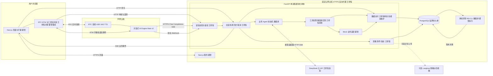
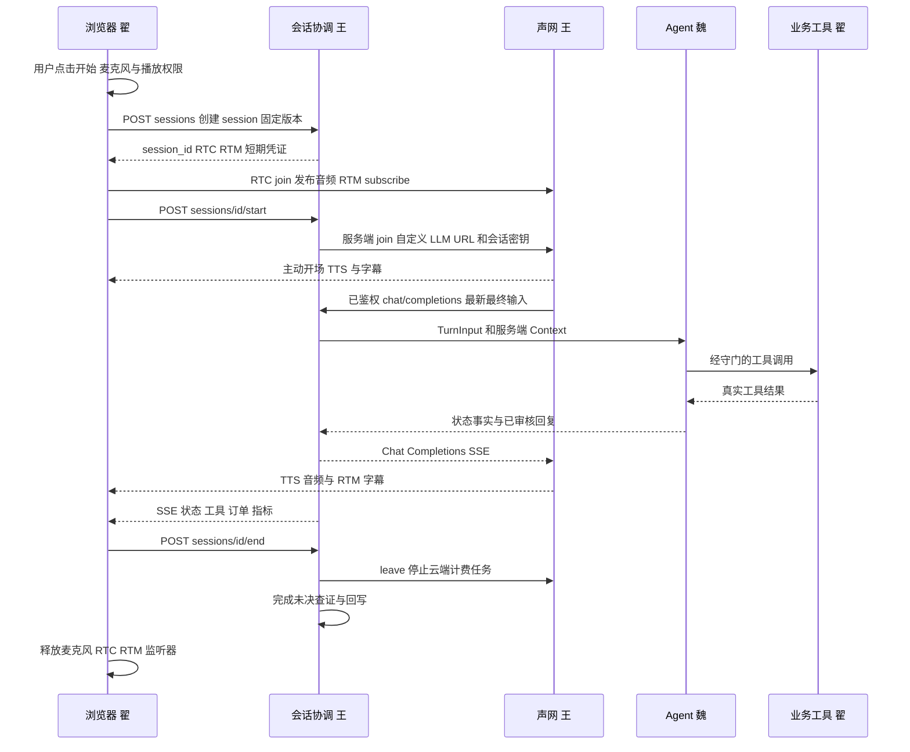

# 架构与实时语音接入

## 模块与部署

音频不经 FastAPI，前端不能直连 DB。业务模块在同一 Python 进程内通过类型化函数交互。Mock 作为 `BusinessPort` 的本地实现；未来官方沙箱通过 HTTP adapter 实现同一端口，不把所有函数都包装成内网 HTTP。

运行服务为反向代理、Next.js、FastAPI、PostgreSQL；离线评测按需执行，不常驻多 Agent。单 FastAPI worker 是首版任务取消注册表的明确前提。未来扩 worker 需要跨进程协调／任务所有权方案，不能只把 worker 数改大。

## 开始和结束的时序

开场固定为“您好，我是智语外呼 AI 模拟客服，本次仅演示模拟套餐变更，不会办理真实业务。请问您愿意继续吗？”随后进入模拟核验。完整身份披露被打断时，下一回复补足必要内容；记录 disclosure 状态，未完成不得提交。开场只一次，重连不重新推销。浏览器自动播放失败时显示“点击开启声音”，不能把已调用 `play()` 当作已听到。

创建只分配会话和浏览器凭证；`start` 在 RTC／RTM 就绪后才创建云 Agent。start 重复请求复用同一启动操作。云端 join 超时不能直接再建 Agent：根据唯一 name/session 映射查询，确认不存在才重试。结束对 leave 重试和查证，DB 记录 orphan agent，进程启动／定时扫描清理，防止关闭页面后持续计费。

## 声网接入契约与验证边界

使用 [Main v2 join](https://docs.agora.io/en/api-reference/api-ref/conversational-ai/join)，不使用 Platform Preview 的 agent 配置。服务端生成 `properties.llm.url=https://<固定域名>/integrations/agora/sessions/{session_id}/v1/chat/completions`，并将会话专用随机密钥放入 `llm.api_key`；密钥不下发浏览器，不在 URL 中。官方接口支持 custom vendor 的轮次信息，适配器以抓取的真实脱敏请求确定字段位置并规范化，不能臆造它在 JSON 顶层。

`session_id` 在路径且必须与密钥绑定；vendor `agent_id/channel/uid` 存服务端。声网管理 REST 凭证与 RTC Token／RTM Token／自定义 LLM 密钥是不同凭证。浏览器只拿限 channel/uid、短有效期的媒体凭证。续期接口检查会话所有者及存活状态。

国内项目暂定使用 `https://api.agora.io/cn/api/conversational-ai-agent/v2/projects/{appid}/join`，国际账号的 Main 文档路径没有 `/cn`。区域 host/path、服务权限和 ASR/TTS 列表以本团队账号控制台导出的配置为准，由 `AGORA_API_BASE` 固定，不能跨区域拼接字段。国内依据：[声网 REST 快速开始](https://doc.shengwang.cn/doc/convoai/restful/get-started/quick-start)。语音 adapter 统一使用 string UID，RTC／RTM／Agent 设置一致并启用相应 string UID 配置；不混用数字 UID 和字符串 UID。Token 在服务端生成，禁止使用在线凭证编码网站。

第一天在部署域名做 P0 验证，证据表见 [集成计划](07-integration.md)：DNS/TLS、公网真实云请求、错误密钥拒绝、session/turn 映射、流式首块、中途取消、结束资源释放。curl 打通 localhost 只能证明本地服务，不是云接入成功。请求经公网反向代理，关闭该路径 SSE 缓冲和压缩缓冲，空闲超时 ≥60s；首部不暴露内部异常。

## 字幕、事件与历史只走一套规则

声网 [实时字幕](https://docs.agora.io/en/ai/build/transcripts) 通过 RTM 工具包处理，包括进行中、完成和中断。语音会话中前端字幕区只订阅工具包一次；按 vendor session/turn/speaker/item 标识更新条目，不每次全量回调追加一遍。语音模式不把后端生成文本再放进字幕区。业务 SSE 的 `state.changed/tool.finished/order.updated/metric.recorded` 来自后端事实，语音 UI 的 listening/thinking/speaking 来自工具包，两个维度分开显示。

后端会话协调器独占模型历史：只从已鉴权的云请求提取**本次最新最终 user 输入**并按 `(provider_binding_id, provider_turn_id, role, item_id/revision)` 去重，再从数据库构造上下文。云传来的 system／assistant／tool 历史只供核对播放情况，不再整体追加。模型 system 来自固定 strategy_version，工具结果来自后端。文本模式由 `/turns` 提供最终输入，语音模式拒绝该接口，避免双重触发。

同一 turn 的 ASR partial 仅显示，不推进业务；final 入库一次。final 更正带 revision：若业务尚未执行可替换并取消旧生成；若已执行则只新增纠错记录、启动查证，不抹掉订单。相同文本在不同 turn 可以合法重复，不能单纯按文本 hash 去重。若真实请求无法提供稳定 turn 标识，语音写操作闸门保持关闭，先补可验证映射；不能以相近时间猜测允许下单。

历史保存 `generated_text`（已生成且通过输出检查）、`played_text`（有播放证据的部分）、`playback_status=complete/partial/unknown`。声网的云端播报／字幕状态只是来源证据，不自动等价于客户端实际可听。未知时不把整段 assistant 当成用户已听到；模型获得“上段被打断，播放范围未知”和真实业务结果摘要。后续签名回调可补全审计，不追溯改变用户确认或已提交订单。较长会话只带最近 12 条消息＋已核验主体／当前报价／确认／订单事实摘要，完整原记录仍保留。

## 打断与任务取消

四种标识分离：`session_id` 为通话；`turn_id` 为后端接收的逻辑轮次；`generation_id` 为该轮某次生成；`operation_id` 为一次持久业务动作。声网 turn 单独映射，不和内部 UUID 混用。

1. 声网 VAD 判断插话并停止 TTS；前端收到实时打断事件后立即冻结旧 generation 的字幕状态，并 HTTP 上报被中断的 vendor turn/generation。实时打断来自客户端工具包，[Webhook 没有同等实时覆盖](https://docs.agora.io/en/ai/build/handle-runtime-events/get-runtime-events)。
2. 会话协调器在短事务中检查 target generation 仍为当前、标记 interrupted、提升 generation_epoch。重复中断返回原结果；晚到的旧 turn 中断只记审计，不取消新轮。
3. 取消注册表中的模型 stream/read task 和可取消查询，关闭上游 HTTP response；SSE 断开也是取消信号，但不假设云端总会及时断开。新 user final 到达时再执行一次旧 generation 失效检查，作为第二道防线。
4. 每次输出 chunk、变更报价、发起工具前检查 epoch；晚到的生成文本／只读查询丢弃，留 trace。工具提交跨越持久 dispatch 边界后不归属于可取消生成任务，继续查证和记录；屏蔽旧播报不等于删除业务事实。
5. 按钮打断走服务端受鉴权接口，同时调用声网 [interrupt REST](https://docs.agora.io/en/api-reference/api-ref/conversational-ai/interrupt) 停止云播放。自然插话已由声网停止时只幂等记录，避免晚发 REST 中断到新一轮。
6. 浏览器断网后禁止新写操作；10s 无心跳暂停，30s 未恢复结束媒体会话。正在执行的提交仍查证；恢复先拉 snapshot＋SSE cursor，再恢复控制。会话结束不撤销已生效订单。

客户端上报是遥测和取消请求，不是权限证明。伪造 `identity_verified`、`played=true` 或 `user_confirmed=true` 一律不生效。确认必须来自已鉴权云最终 ASR＋服务端确认窗口，文本开发模式只接受服务器绑定的受控测试身份。客户端播放遥测仅用于 UX 和测量。

## 输出与持久化顺序

`接收 final →持久化输入→状态与工具权限检查→工具事实入库→状态及审计事件同事务提交→SSE 发布→合规回复给 TTS`。网络调用不占数据库长事务。模型给出的工具建议先完整解析参数并验证，再执行；工具调用 JSON 绝不能播给用户。响应在事实生成前只能使用审核过的中性提示，不以填充语气词粉饰延迟。

系统启动先恢复 `dispatching/unknown/writeback_pending` 操作；应用不可依赖仅存内存的任务保证业务完成。进程退出停止新接入、取消可取消任务，未决操作留 DB 下次恢复。日志故障不能隐藏订单结果；关键审计无法持久化时不允许派发新的写操作。
