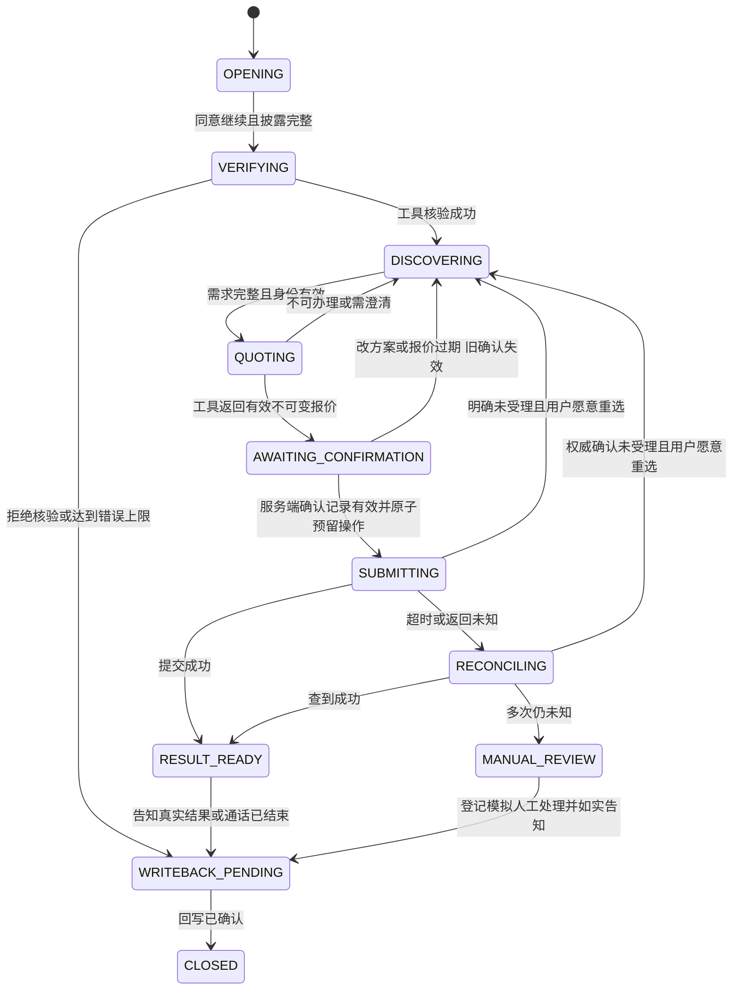

# 业务状态机与执行约束

负责人：魏鼎承。王梓恒审查权限和并发边界，翟雯提供同一契约的业务实现。模型只产生意图、槽位、话术和工具建议，不能直接更新状态、确认记录或订单。

## 合成业务规则 mock-v1

服务对象固定为会话服务器分配的合成 customer，不接受模型任意指定用户。演示核验用单次合成挑战码，最多 2 次错误；只存挑战盐化摘要与匹配结果，原始输入仅核验期间存在于内存。说“我是本人”不能通过核验；文档中手机号后四位的示例不构成真实认证方案。

测试者从翟维护的合成测试卡取得挑战值，例如“合成用户 A，模拟挑战码 4726”；测试卡只用于测试人员，不由客服在通话里告诉用户答案。Mock 为每个 session 绑定卡片、生成独立盐和有效期，成功后单次消费。固定合成测试值可以进入合成 fixtures，原始用户输入不进运行日志；这只是验证业务守门流程，不能宣称固定测试值实现了真实身份安全。正式资料若要求动态验证或其他核验方法，由 Identity adapter 替换。

套餐 `basic_39` 为模拟基础套餐 3900 分／月、`family_59` 为模拟家庭套餐 5900 分／月，人民币，次月 1 日生效、无合约期、无额外一次性费，仅供模拟。可办理范围由 Mock 返回，不写死在 Prompt。报价包含 `quote_id/revision/plan_id/price_minor/currency/billing_period/effective_at/terms_version/eligibility/valid_until`；有效 5 分钟，任何条款改变都新建报价并撤销旧确认。

开场先自报 AI 身份与模拟说明，再问是否继续。用户拒绝则结束，不要求核验；同意继续才核验，不提前透露账户业务。首版每 session 至多一个生效套餐变更；已提交后改主意进入查证／模拟人工工单，不用“回到需求确认”制造第二单。

## 三个正交状态

- `call_status`：created → connecting → active ↔ reconnecting → ending → ended／failed；控制媒体生命周期。
- `business_state`：下图业务流程；通话 ended 不代表订单 failed。
- `operation_status`：reserved → dispatching → succeeded／failed／unknown → reconciling → succeeded／failed／manual_review；取消只能发生在安全边界之前。

任一尚未派发写操作的非终态收到明确整体拒绝，撤销有效确认、禁止新业务、写 outcome=user_refused，进入 WRITEBACK_PENDING。已派发时收到拒绝立即停止说服和新操作，但保留查证；最终标记 `user_refused_after_dispatch` 和真实订单结果。拒绝“这个套餐”且要求另一套餐属于改方案，不等于拒绝整次服务。无上下文的“取消”先澄清是否结束通话／取消选择，不能擅自取消业务订单。

## 状态转移与禁止行为

| 当前状态 | 允许事件与条件 | 动作／下一状态 | 明确禁止 |
|---|---|---|---|
| OPENING | 开场披露完成；用户同意继续 | 发模拟挑战→VERIFYING | 查询套餐账户、提交、把静默当同意 |
| VERIFYING | 最终用户输入；verify_identity 返回 match | 记录 verified_subject、attempt、有效期→DISCOVERING | 模型自称通过；查询其他主体；泄露正确挑战值 |
| VERIFYING | 核验失败 <2 次／达到上限 | 原状态重新询问／结束并回写 | 无限猜测；用失败请求查账户存在性 |
| DISCOVERING | 需求槽位完整且核验有效 | 查询可办范围→QUOTING | 用 Prompt 内价格代替查询结果 |
| QUOTING | 有效工具结果且 generation 未过期 | 固化报价、输出条款→AWAITING_CONFIRMATION | 采用过期查询的报价覆盖新方案 |
| AWAITING_CONFIRMATION | 当前报价未过期，用户明确确认具体条款 | ConfirmationService 验证证据，创建记录，事务内预留提交→SUBMITTING | 接受客户端布尔值；模糊“随便”；确认旧方案 |
| SUBMITTING | 本 operation 的确定成功 | 固化结果→RESULT_READY | 因用户插话取消 DB 事实；换幂等键重试 |
| SUBMITTING | 已派发后超时／连接丢失 | 标 unknown→RECONCILING | 返回“失败，请再办一次” |
| RESULT_READY | 结果已持久化 | 审核模板告知；保存结果送达状态；回写 | 用“已提交”冒充“已生效”；等待用户应答才保存订单 |
| RECONCILING | query_operation 原操作查证 | 成功／明确失败／继续未知 | 旧 query not_found 就立即重下单 |
| WRITEBACK_PENDING | 幂等回写成功／失败 | CLOSED／保留 pending 重试 | 回写失败就撤销成功订单；关闭记录伪称完整闭环 |
| CLOSED | 只读、重复幂等操作、订单后台事实补充 | 不重开业务 | 新确认、提交、修改固定策略版本 |

核验默认在本会话 10 分钟有效。失效后阻止新敏感查询和提交，重核验会使旧确认失效；已有操作查证由受限系统身份完成，不要求用户重复提供凭据。

## 确认记录的成立条件

`ConfirmationService` 只处理当前 `AWAITING_CONFIRMATION` 的最终输入。它从 DB 取 session／verified_subject／active_quote／最近确认提示，不从模型或浏览器读取 `user_confirmed`。

记录需同时满足：

1. 输入来自本会话的已鉴权语音最终 ASR，或受控 text 模拟入口；可定位 `evidence_message_id/turn_id`，非 assistant 转述、非 partial、非上轮重放。
2. 用户表达明确购买意愿、无否定／条件／方案变化，且明确对象与当前报价一致。模型可提议 intent，但代码决定能否建立确认；冲突或不确定时再次澄清。
3. 首版语音安全策略：让用户明确复述“确认办理家庭套餐，每月五十九元，次月生效，无合约期、无额外费用”等核心条款；规范化中文数字后精确匹配当前报价。单独“好”“确认”不直接触发写入，改用审核提示请其完整确认。这样不依赖客户端伪造的播放完成事件证明用户知道条款。后续若官方允许简短确认，须增加可信的报价完整告知证据后再调整规则。
4. 记录 `quote_id/quote_hash/terms_version/verified_subject_id/confirmation_rule_version/evidence_message_id/created_at/expires_at`，有效期不超过报价与核验期限。
5. 同一事务验证 `state_revision`，保存确认、把报价绑定的 submit operation 预留并唯一化；实际派发前再次验证。需求变化／拒绝先到则撤销预留；派发先到则进入结果查证，禁止承诺撤回。

完整复述是本团队模拟业务的安全取舍，不声称赛题强制这么说。它会增加对话长度与 ASR 负担，必须通过真实语音回归；低置信／缺失字段时宁可重新询问，也不让 LLM 猜测同意。

## 工具守门与原子边界

所有工具由 allowlist 分发。模型可建议 `verify_identity/query_plans/select_quote/request_submit`；后端从 Context 注入 session、subject、quote 和 operation，拒绝未知字段。`request_submit` 是意图建议，实际 `submit_change` 由协调器在安全前提满足后派发。模型无权调用回滚、采纳版本、修改阈值或 SQL。

提交步骤：短事务锁 session 行→验证状态／revision／核验／报价／确认／拒绝标志→创建唯一 operation 和稳定幂等键→提交；执行器再以 CAS 将 reserved→dispatching（同事务复查条件，作为不可取消边界）；释放锁后调用业务适配器；结果在独立事务中保存。模型生成取消不能取消这个持久执行器。DB 唯一约束兜底，并发请求最多创建一个 operation。

## 异常矩阵

| 情况 | 系统动作 | 用户与前端看到的事实 | 重试策略 |
|---|---|---|---|
| 身份失败 | 计次数；保留非敏感状态；上限结束 | 核验未通过，不提示正确值 | 最多 2 次，不自动重试 |
| 只读工具失败 | 不编造结果；保留已核验事实 | 暂无法查询，可重试／结束 | 可重试错误一次，总预算内 |
| 模型超时／非法工具参数 | 取消 generation，不推进未证实业务 | 审核兜底话术，询问是否继续 | 默认不自动重复整轮；由新输入继续 |
| 断网／页面关闭 | 暂停新写入、媒体回收；继续已派发查证 | 重连后显示 snapshot，不从 UI 缓存推测成功 | 控制请求同幂等键；短时恢复同 session |
| 重复提交 | 先查 operation，再返回缓存／pending | 同一个订单或待查状态 | 相同键＋相同 payload；不同 payload 409 |
| 提交超时／响应丢失 | unknown；以原幂等键查询 | “结果待确认”，禁新订单 | 1s、3s、10s 查证；30s 仍未知转模拟人工 |
| 用户改方案 | 派发前撤销旧确认和 reserved 操作；重新报价 | 当前报价与版本变化 | 新报价必须新确认；派发后先查证 |
| 回写失败 | 订单成功保留；writeback_pending | “业务已提交／已生效，记录待同步” | 1s、3s、10s 后后台定时再试，恢复可续跑 |
| 用户合理拒绝 | 停止推销及新业务；撤销未执行确认 | 正常结束，独立 outcome | 不再追问、重营销 |

`not_found` 只有在业务系统明确保证“最终未受理”时可判 failed；否则仍 unknown。Mock 必须区分 `not_found_yet` 与 `definitively_not_submitted`。首次查询查不到订单并不是失败证据。
