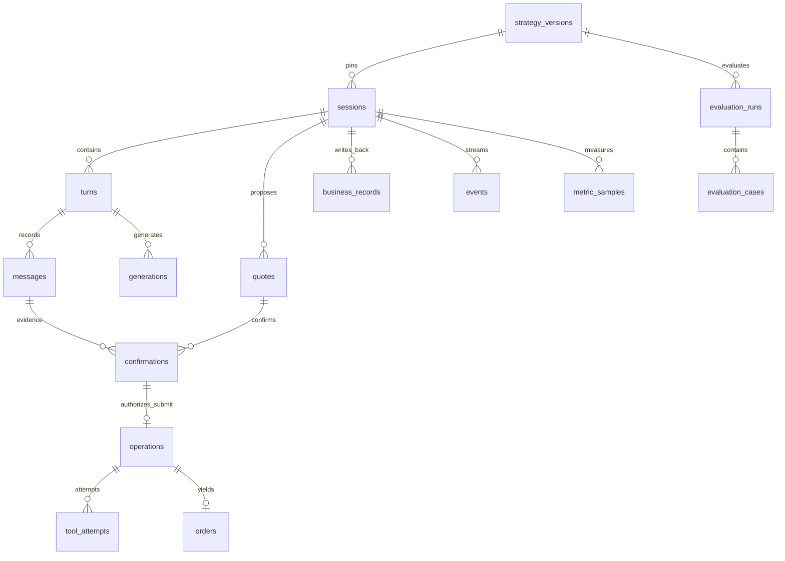

# 数据模型与生命周期

PostgreSQL 是会话、确认、操作与订单事实的唯一权威存储。Langfuse 是可选 trace 派生视图；JSONL／评测结果文件是不可变的证据导出，不在运行时反向覆盖 DB。模型上下文是按需投影，不能形成第二个可写业务状态。

## 表与关系

字段约定：主键 UUID；时间 `timestamptz`；金额 `integer`；版本引用不可变；正文和工具参数先脱敏再入库。JSONB 用于扩展元数据，不把核验／确认／状态等关键条件都藏进一个 JSON blob。

| 表与所有者 | 主要字段 | 关系／索引与约束 |
|---|---|---|
| sessions 王 | id, owner_id, mode, scenario, call_status, business_state, state_revision, generation_epoch, current_generation_id, active_quote_id, strategy_version_id, rule_version, data_version, model_config_version, outcome, disclosure_status, created_at, ended_at | owner_id+created_at；call_status+updated_at；strategy FK；状态 CAS |
| provider_bindings 王 | id, session_id, provider, agent_id, channel, browser_uid, agent_uid, credential_hash, expires_at, status | unique(provider,agent_id)；unique(channel)；session 可多次绑定但最多一个 active；密钥不明文保存 |
| turns 王 | id, session_id, ordinal, provider_binding_id, provider_turn_id, kind, input_revision, outcome, started_at, ended_at | unique(session_id,ordinal)；unique(binding,provider_turn_id,kind)，NULL 的 text 模式由 client_event 唯一约束 |
| generations 王 | id, turn_id, epoch, status, model_request_id, started_at, cancelled_at, completed_at, cancel_reason | turn_id+epoch；session 当前 generation 引用；取消后不接收输出 |
| messages 王 | id, session_id, turn_id, role, source_item_id, revision, redacted_text, generated_text, played_text, playback_status, playback_evidence_source, interrupted, created_at | unique(turn_id,role,source_item_id,revision)；session_id+created_at；partial 短期缓存，final 永久标记 |
| identity_verifications 魏 | id, session_id, subject_ref, challenge_digest, attempts, status, verified_at, expires_at, rule_version | session_id+status；不存挑战原文；subject 不来自模型；失败不暴露主体详情 |
| quotes 翟维护数据 魏控制选择 | id, session_id, revision, plan_id, price_minor, currency, billing_period, effective_at, terms_version, terms_snapshot, quote_hash, eligibility, valid_until, superseded_at | unique(session_id,revision)；snapshot 不可变；session 只能选择本主体查询所得有效 quote |
| confirmations 魏 | id, session_id, quote_id, quote_hash, verification_id, evidence_message_id, confirmation_rule_version, created_at, expires_at, revoked_at, revoke_reason, consumed_operation_id | FK quote/message/verification；unique(quote_id,evidence_message_id)；quote_id+revoked_at；提交时检查所有绑定 |
| operations 王骨架 魏语义 | id, session_id, turn_id, generation_id, kind, quote_id, confirmation_id, idempotency_key, payload_hash, status, deadline_at, dispatched_at, provider_reference, last_error_code, next_attempt_at, attempt_count, result_json | unique(idempotency_key)；(status,next_attempt_at)恢复扫描；submit 的 quote 唯一；部分唯一索引防同 session 未决／成功多单 |
| tool_attempts 翟／魏 | id, operation_id, attempt_no, tool_name, redacted_args, started_at, ended_at, status, error_code, provider_request_id, redacted_result | unique(operation_id,attempt_no)；tool_name+started_at；失败尝试不可覆盖 |
| orders 翟 | id, operation_id, provider_order_id, subject_ref, quote_id, provider_status, price_minor, effective_at, result_received_at | unique(operation_id)；unique(provider_order_id) 在非空时；订单事实不随 turn 取消删除 |
| business_records 翟 | id, session_id, revision, record_json, writeback_operation_id, writeback_status, written_at | unique(session_id,revision)；记录 quote/confirmation/order/版本和实际 outcome |
| events 王 | id, session_id, seq, type, state_revision, turn_id, generation_id, operation_id, redacted_payload, created_at | unique(session_id,seq)；session+seq 重放；状态与关键事件同事务 |
| provider_receipts 王 | provider, notice_id, binding_id, received_at, sanitized_payload, processing_status, attempt_count | unique(provider,notice_id)；processing_status；仅已验签内容进入此表 |
| request_receipts 王 | owner_id, route, key, request_hash, response_status, redacted_response, resource_id, created_at, expires_at | unique(owner_id,route,key)；expires_at 清理；秘密凭证不缓存在通用日志中 |
| metric_samples 王 | id, session_id, turn_id, generation_id, metric, value_ms, source, clock_domain, sample_status, exclusion_reason, received_at, uncertainty_ms | session+metric；metric+received_at；unique(turn,generation,metric,source,measurement_id) 实现去重 |
| strategy_versions 魏 | id, parent_id, prompt_content, talk_templates, content_hash, rule_version, model_config_version, data_version, created_at, status, evidence_run_id | unique(content_hash,rule_version,model_config_version,data_version)；版本不可原地修改 |
| active_strategy 魏／王 | scenario PK, current_version_id, previous_version_id, revision, changed_at | 单行原子 CAS；会话创建事务读 current 后固定 |
| evaluation_runs 魏 | id, baseline_id, candidate_id, dataset_id, dataset_hash, code_revision, config_hash, seed, started_at, status, summary_json, evidence_uri, evidence_sha256 | candidate+created_at；版本、数据集和配置不可缺失；不得只存平均分 |
| evaluation_cases 魏 | run_id, case_id, repetition, session_id, assertions_json, outcome, failure_category, evidence_refs, latency_summary | unique(run_id,case_id,repetition)；失败分类；引用真实工具／状态证据 |
| strategy_decisions 魏 | id, action, target_version_id, previous_version_id, evaluation_run_id, gate_version, reasons, actor, created_at | append-only；记录拒绝与回滚，不能只记成功采纳 |
| audio_assets 王 可选 | id, session_id, object_key, sha256, format, sample_rate, channels, duration_ms, recording_scope, consent_record_ref, expires_at | 音频在私有文件卷／对象存储，DB 只存元数据；object_key unique |



`confirmations → operations` 表示 submit 操作的授权关系；查询／回写 operation 没有 confirmation FK。报价过期只是不能新授权，不破坏已派发操作的审计记录。禁止级联删除会话时意外删除未决订单；清理前先检查 operation 已收敛。

## 事务与竞态

更新业务时按 `sessions.state_revision` 做 compare-and-swap，失败返回 STATE_CONFLICT，重新读取再决定；`generation_epoch` 防旧生成，不能替代业务 revision。PostgreSQL 在确认和预留提交的短事务中锁 session 行，唯一索引负责最终兜底。[PostgreSQL 行锁](https://www.postgresql.org/docs/18/explicit-locking.html)

建议索引草案（具体名称随迁移固定）：

```sql
CREATE UNIQUE INDEX uq_operation_key ON operations (idempotency_key);
CREATE UNIQUE INDEX uq_event_seq ON events (session_id, seq);
CREATE UNIQUE INDEX uq_order_operation ON orders (operation_id);
CREATE UNIQUE INDEX uq_active_submit ON operations (session_id)
  WHERE kind = 'submit_change'
    AND status IN ('reserved','dispatching','unknown','reconciling','succeeded','manual_review');
```

需求变化只有在 reserved 且尚未派发时可撤销 operation 并释放该约束。查询到最终未受理才标 failed；unknown 不解除。人工处理本版不创建第二个自动订单。

状态修改和待推送事件在同一个事务中写入；提交后再发布 SSE。发布失败时前端按 cursor 重放。这里的 events 表兼任本地持久事件记录，不引入外部消息队列。恢复扫描仅处理持久 pending 操作，领取采用状态 CAS／短租约，网络请求在事务外。

业务适配器可能在外部成功但本地落库前崩溃。恢复时 `dispatching` 超过 deadline 的操作进入 unknown，使用原 operation/key 查证，拿到结果后补齐订单、业务状态和回写事件。不能因为本地找不到 order 行就再次提交。Mock 的订单数据本身持久化，进程重启不能清空它造成误判。

## 归属与保留

| 数据 | 权威写入者 | 生命周期／默认保留 | 清理与导出 |
|---|---|---|---|
| 活跃会话与任务注册表 | SessionCoordinator | DB 持久；内存任务仅通话期间，最长 10 分钟 | 崩溃恢复 DB，不恢复已失效生成 |
| 最终消息、状态、确认、操作、订单 | 各领域经 Repository | 合成开发数据 30 天；未决操作保留至查证完成 | 合规导出后可清理；禁止抹掉未知操作 |
| partial ASR、音频缓冲、原核验值 | 语音适配器 | 内存数秒到本轮结束 | 不上传 Langfuse，不进通用日志 |
| 识别／播放／打断事件 | 语音 adapter 规范化，server 标来源 | 细粒度遥测 7 天，审计终态并入通话记录 30 天 | 同事件标识去重，不能把供应商重放算新轮 |
| SSE 重放事件 | Coordinator | 至少 24 小时，之后可保留审计摘要 | cursor 失效明确提示；删除不破坏业务记录 |
| Prompt／策略和采纳证据 | RSI | 合成实验版本随项目保留；不可变 hash | Git 可存模板和合成用例；真实来源资料按授权保留 |
| Trace／指标／评测原证据 | Observability／Evaluation | 开发 30 天，演示证据经筛选归档 | 冷存储一次；DB 保存 URI/hash，不复制录音 blob |
| 录音 | 明示开启的采集流程 | 默认不持续录音；自测／演示明确记录后 7 天，可选保留最终演示片段 | 文件与 metadata 同步删除；私有授权读取，不公链 |

上述期限是合成开发数据的团队默认值，不是法律结论。官方资料不得外传、现场评测数据赛后回收销毁，优先于默认 30 天规则（R p7–8）。如官方资料限制第三方处理，关闭 Langfuse Cloud，并确认云模型／ASR 使用许可；不把原始资料传外部服务进行复盘。

## 脱敏与证据真实性

统一 `Redactor` 位于 DB／日志／追踪出口之前：挑战码／Token 全删除，客户标识伪名化，姓名／手机号／证件号等检测遮盖，工具只记 allowlist 字段。异常堆栈、HTTP 访问日志、SSE debug、评测导出也经过同一规则；不能只在网页遮盖。敏感低熵凭据不要裸 SHA256，可用服务端 HMAC／盐化验证并限制尝试。

业务必要的未经脱敏字段只在验证／工具调用所需短时内存使用。`evidence_message_id` 指向脱敏后的确认语句，方案名、价格等业务证据保留；不保留完整手机号来证明核验。核验凭据摘要与核验结果足以做审计。

“原始评测证据”指未篡改的**脱敏采集原记录**，含事件次序、工具事实、断言、模型响应、版本及 hash；不等于必须保留个人敏感原文。每次导出生成 manifest 和 SHA256，禁止为了更好分数改写失败样本。音频更难脱敏，因此只录合成测试脚本，并限制访问；文件删除与 metadata 删除要有清理记录。

## 结构化回写最小内容

BusinessRecord 包含 session、call outcome、business outcome、identity status、需求槽位、quote/confirmation/order/operation 引用、订单状态、结果送达状态、规则与策略版本、状态路径、合规检查摘要、失败分类、pending action。`business_completed=true` 仅在业务终态符合目标且该版回写已确认时计算，不能由模型写入。用户拒绝也是完整记录，但不是“成功办理”。
