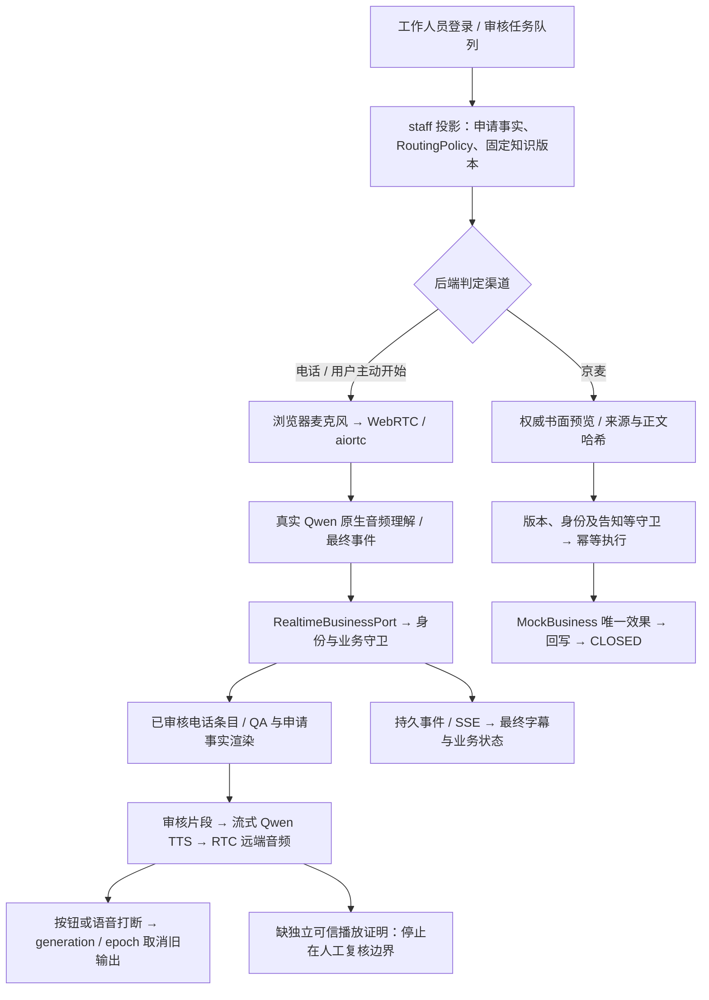

# 2026-11-25 DDL 交付：v3 真实语音恢复与复测

后续定向优化已完成：最新固定配比30有效回答P50 2112ms/P95 2836ms，整体仍未达标；534项后端、5项浏览器通过。本文保留b820601阶段证据，最新结果与回滚见 [定向优化交付](ddl-latency-optimization-20261125.md)。

本轮在独立分支 `codex/ddl-realtime-delivery-20261125` 工作，保护原 3000/8000 服务、原数据库和其他工作树。真实语音修复代码冻结点为 `679ed92`；业务知识固定为 `workbench-reviewed-20261125-v3`。最终验证状态见本文末尾与机器报告，不能用旧版成绩替代新版。

## 之前为何无法使用

13000 的生产前端实际代理 18000，但旧演示启动脚本关闭了 REALTIME_WEBRTC_ENABLED 和 CLOUD_CALLS_ENABLED，并使用 manual TTS。独立工作树没有根目录供应商 .env，业务工作台发布不等于启动进程继承了旧实时配置。此外，不同 localhost 端口共享同名 Cookie，会覆盖工作人员/商家登录；恢复的旧文字会话也没有 RTC 媒体绑定，不能直接当成语音会话启动。

这属于运行配置、登录隔离和会话接线问题，不能据此推断已经完成的业务封装和 WebRTC 必须重新开发。RTC 建连只证明信令和媒体连接，不能证明麦克风有信号、模型产生了最终理解、身份守卫允许回答，以及浏览器实际收到有效音频。

## 修改与保留的约束

- 新增专用启动入口 scripts/start_workbench_demo.ps1 和 scripts/workbench_runtime.py；只从已有根 .env 白名单读取供应商参数，不复制密钥，不改变模型/音色/VAD，不在启动时调用云服务。
- 专用工作人员/商家 Cookie 名称避免覆盖旧服务登录；签名、角色、owner 和 Origin 校验继续执行，默认 Cookie 名保持兼容。
- 前端恢复文字会话时明确提示建立独立语音会话；切换交互方式建立匹配的后端会话，活动通话期间禁止切换。增加分阶段连接错误和代理非 JSON 错误信息。
- VOICE_WRITES_ENABLED=false；浏览器播放、RTP 发完、playback.drained 都没有提升为可信业务告知证据。不放宽身份、审核知识、幂等、版本及回写守卫。
- 新增完整 v3 真实浏览器回归与测量热路径边界观测。测量脚本将长审核答复的播完等待从 23 秒改为 60 秒，首音频测量方法不变；原超时和中断轮次全部保留，同一运行账本续测。

## 数据如何流动



原生模型直接接收音频并输出理解事件；业务模块决定能说什么，审核后的文本再交给流式 TTS。当前实现并非让端到端语音模型自由生成最终业务语音。工作人员可以看审核事实，商家在身份核验前不能获知具体品牌及驳回原因。字幕来自服务端最终理解与持久消息，当前不提供临时识别字幕；工作人员页面的麦克风音量用于区分无输入与理解失败。

当前是模块化后端中的异步 RTC 接收、独立任务、有界媒体队列、取消生命周期及 PostgreSQL 持久业务状态。启动演示仍为单个 uvicorn 进程；本轮没有验证跨实例会话迁移、多个 worker 或并发容量。已经实现实时接线，不等于横向扩展和全部赛题验收均已完成。

## 完整 v3 真实语音回归

使用正式工作台、真实 Chromium、aiortc、现有北京供应商原生理解和流式 TTS；只用固定 WAV 替代自动测试麦克风输入，没有向文字接口塞字幕。验证实际开场音频、明确商家身份、v3 被授权方盖章事实、授权书位置上传 QA、不保证通过、说话自动打断、刷新后同会话重连和实际远端 PCM。挂断后书面执行仍受可信告知守卫阻止，语音业务操作为零。

第一次冒烟使用“是的，我就是联系人”的含混音频，被身份守卫正确拒绝；失败记录保留，后续采用明确的演示商家身份音频。完整回归通过不代表物理麦克风/扬声器、可信播放或公网/TURN已验收。

完整语音冒烟在修复后的工作区、提交前执行，因此原始记录的 git HEAD 仍为 fb0fed7；随后将同一应用修复冻结为 679ed92。正式 30 轮测量使用 679ed92；后续仅调整测试等待、启动/验收防误连及文档，没有更换实时应用逻辑。

证据：[脱敏语音结果](ddl-real-voice-20261125.json)，[真实工作台截图](screenshots/ddl-v3-real-voice.png)。原始证据位于忽略的 .cache/ddl，哈希写入机器报告。

## 启动与现场演示

从本工作树执行：

```powershell
& .\scripts\start_workbench_demo.ps1 -Restart
# 若前端尚未构建或修改了产品代码：追加 -Build
```

打开 http://localhost:13000，工作人员账号 demo，当前本机演示密码 staff-local-only（若通过 STAFF_PASSWORD 覆盖，以运行配置为准）。需先存在已迁移、播种且发布 v3 的专用数据库，PostgreSQL 端口 55439 可用；脚本不会清库、重置配额或覆盖申请事实。根 .env 保留既有供应商凭据，其他位置可用 VOICE_CONFIG_ENV_FILE 指定。新环境需要先安装依赖和 PostgreSQL，本入口不是生产部署脚本。

选择前三个电话任务之一，在开发设置选择 WebRTC 实时语音；如恢复旧文字记录，先结束活动文字会话再点击“建立实时语音会话”。点“开始通话”，允许麦克风，戴耳机避免回声。任务 1 可依次说：

1. “我是演示商家一的联系人。”
2. “我的授权书缺少哪些内容？”
3. “联系方式在哪里上传？”
4. 在播报时说“补齐材料一定能通过吗？”验证打断与不保证通过。
5. “这个要求的依据是什么？”

麦克风条不动时检查浏览器站点权限及系统输入设备；条动但无最终字幕时检查原生理解错误提示和后端日志；连接失败按麦克风、AudioContext、ICE、offer、控制通道的阶段提示定位。旧文字会话不会因页面选择语音就获得媒体绑定。localhost Cookie 隔离后需要重新登录新工作台。

电话正常挂断后继续展示书面预览，但真实语音没有可信告知证明时不能执行自动回写。独立的文字/书面演示可在开发设置选择文字，按后端流程核验身份和告知；直接京麦任务只展示书面操作，不渲染语音组件。不要把这两条独立证据拼成自动语音关单。

## 赛题覆盖与剩余迭代

已发布 6/68 个原始场景，电话支持 3 个、书面支持 6 个（重叠）；11 个合成任务。原表统计 54 电话/14 京麦，与 Word 所述 55/13 差异保持记录。RoutingPolicy 依据后端事实分流，执行和回写来自持久状态，前端没有伪造成功。

仍未完成：62 个原始场景和尚未发布 QA；真实电话供应商联系事件；独立可信播放及语音自动关单；真实京麦写接口；公网 HTTPS/WebSocket/ICE/TURN 与弱网验收；真实物理设备人工回归；多实例、多 worker 和并发容量；生产身份/租户权限及官方评分。先补可信播放与供应商事实、完成授权知识，再做受控并发和公网测试。不能以 UI 展示或本地环回通过代替这些结果。

## 最终验证记录

后端全量 **517 passed、0 failed、0 skipped**，用新建的 zhiyu_ddl_regression_20261125_test 数据库运行，约 80 秒；存在一条 Starlette 测试依赖弃用提醒。TypeScript 类型检查通过；设置 BACKEND_URL=http://127.0.0.1:18000 的 Webpack 生产构建通过。本机依赖目录跨工作树链接，未将此结果当作默认 Turbopack 或远端 CI 的结果。

最终浏览器 **5 passed**：三个授权电话场景、直接京麦及三次提交、未接通分流、实际跟进后再联系、身份前脱敏、书面预览、幂等与刷新恢复、未知状态不冒充成功、加载失败、桌面/移动布局、旧文字会话显式建立 RTC 会话，以及读取/恢复不自动调用媒体。新建 zhiyu_ddl_browser_20261125_test 保存 10 个会话、10 个成功操作、10 个业务效果、10 条回写；9 次 reject + 1 次 followup，9 个申请闭环，事件 seq 连续。语音操作仍为零，不能据此宣称语音自动关单。

第一次浏览器回归时重建漏设 BACKEND_URL，产物指向默认 8000，登录被旧服务 Origin 守卫拒绝；无测试会话产生。保留失败日志，纠正构建后在同一零会话数据库重测。验收脚本现先核对产物代理，启动脚本发现目标不符会重新构建，防止静态 rewrites 误连原服务。

一键启动实测退出码 0。恢复后只读复核：13000 → 18000；realtime_webrtc=true、不可用原因为空；v3 发布 6 场景；仅 zhiyu_ddl_staff / zhiyu_ddl_session Cookie；语音写入关闭。原 3000/8000 仍由原 PID 31544/8608 监听。legacy voice=false 表示未启用旧声网模式，不代表 WebRTC 不可用。

## v3 延迟结果与瓶颈

[分项和完整失败记录](ddl-real-latency-20261125.json)；[原脚本比较输出](ddl-latency-comparison-20261125.json)。本轮 **未通过性能验收**。

| 指标 | 旧基线 | 本轮 v3 | 验收 |
|---|---:|---:|---|
| 有效/尝试轮次 | 30/31 | 30/36 | 样本数满足 |
| 有效答案 P50 | 1621.3ms | **2077.8ms** | 严格小于 2000ms：不通过 |
| 有效答案 P95 | 2128.6ms | **5323.2ms** | 小于等于旧版 110%（2341.46ms）：不通过 |
| 全部尝试失败率 | 3.23% | **16.67%** | 不增加：不通过 |

30 个有效回答里只有 11 个严格低于 2 秒。6 个失败保留：4 个旧脚本播完等待超时、1 个修正等待上限时中断的客户端轮次、1 个真实 TTS_TIMEOUT。前五个不能简单叫业务/模型失败；同样不能将它们删掉后宣称整体验收通过。即便单独看有效答案，本轮 P50 和 P95 也未过线。

| 语音结束后各段 | P50 | P95 |
|---|---:|---:|
| 输入传输、结束检测及事件返回 | 604.1ms | 3235.8ms |
| 结束检测后原生理解 | 485ms | 734ms |
| 业务审核与片段事件发布 | 62ms | 78ms |
| 派发到合成 | 低于时钟分辨率 | 低于时钟分辨率 |
| 流式 TTS 首 PCM | 578ms | 1843ms |
| 首 PCM 到浏览器观测 | 246.8ms | 323.1ms |

业务受理子段 P50 15ms/P95 16ms；业务 Agent 决策与派发短段部分落在 Windows 15.625ms 计时分辨率以下，零值不代表没有工作。**各段 P50 不能直接相加得到总体 P50**。结束检测段包含上行传输、供应商 VAD 与返回传输，不能进一步武断归因于供应商内部某一步。

逐轮核对全部 30 个有效回答的意图、审核正文和远端 PCM：v3 身份后的缺项含授权期限、被授权方盖章；保证问题明确拒绝保证；来源问题给出已审核依据。六段求和与端到端计量一致，全部正文匹配对应 generation 的审核片段。14 个测试会话均绑定 v3，效果和操作均为零，FakeModel.stream 调用为零。MODEL_PROVIDER=fake 只保留文字演示/默认配置，不作为此实时测量的模型。

固定音频、案例哈希、原生适配器源码、模型参数及浏览器计量方法与旧版相同。比较脚本四个同条件元数据检查通过，但两天真实 WAN 不受控；早期失败使成功样本分布不同（身份 14、保证 8、来源 8），所以同时提供逐案例统计，不能把 28.2% P50 回退全部因果归给 v3 业务升级。方法测量浏览器远端解码音频，未测物理扬声器出声，也不是可信告知证明。

预算没有重置：同一运行账本使用 14/15 次原生连接、42/45 个保守预留轮次、50/120 次 TTS 尝试。重启客户端仅续写原记录，失败未剔除；供应商金额与账户余额未估算。

## 有证据支持的下一步

1. 优先复测结束检测与上行：加入固定静音、连续语音和不同停顿长度的用例，测 speech_stopped 相对有效语音结束的偏移、帧发送间隔及返回抖动。当前 server_vad=400ms；如试验缩短静音，只能作为单独变体，同时验证误截断、身份准确率和插话，不能混入本轮固定参数数据。
2. 优先处理 TTS 尾延迟和一次超时：记录请求/首 PCM/总时长，核对连接复用和超时；只在供应商明确允许且旧 generation 尚未生效时评估可取消的有界重试。禁止靠填充词和已取消片段制造首音频。审核后的长话术需要进一步做来源可追溯的精简/分段审核，先验证事实完整性和打断。
3. 浏览器段 P50 约 247ms，再检查 RTP/解码缓冲和 AudioContext 观测延迟；240ms 队列上限不是已达成端到端延迟。必须保留乱序/旧音频屏蔽和取消清理。
4. 本轮业务热路径约 62ms，没有观察到工作人员书面预览进入热路径，也没有额外 FakeModel 文本生成。没有实施大规模重构或缓存来假装解决秒级尾延迟。多 worker/跨实例应独立做会话归属、取消路由和并发测试，不能当作单轮延迟优化的替代品。
5. 在同一冻结版本、固定案例配比和可比网络下完成新的至少 30 有效轮次，保留所有超时及失败，再运行相同验收脚本。当前版本不能贴“P50<2秒已达标”的交付标签。

最终代码在独立分支提交，PR 说明另见 ddl-pr-description-20261125.md；未覆盖 main，未改线上数据库。本报告与机器证据保留明确未通过项。

