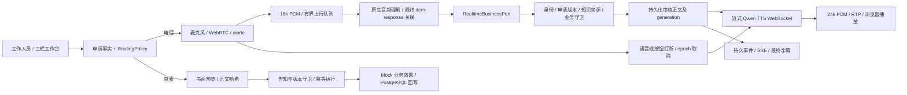

# 智语外呼：2026-11-25 封版交付

最终配置为 server_vad 400ms / threshold 0.5、Qwen-Audio-3.1-TTS-Flash WebSocket、longanhuan_v3.1、24kHz 单声道 PCM。应用冻结点 `d164cd1`，知识版本 `workbench-reviewed-20261125-v3`。语义断句、正文重排、分段、预取、模型直出均不进入默认交付链路。**正式结果：30/30 有效、P50 1774.2ms、P95 1971.3ms、失败率 0%，10 通各连续三轮，身份/保证/来源各10轮。** P50严格低于2000ms；观察到的P95低于2341.46ms，失败率低于旧基线1/31。历史输入音频与测量口径匹配，但日期、WAN、知识正文不同，不能把元数据匹配当成严格同期同条件A/B。最终数值以同目录 `ddl-final-performance-20261125.json` 为准。

## 数据流与架构



实时不等于零等待：本系统流式上传音频，原生模型给出最终理解后，业务审核正文，再流式合成和播放。它没有额外串接传统 ASR→另一个通用语言模型，但也没有让模型自由生成的未审核音频直接播放。WebRTC 已连接，只代表媒体通道存在，仍需检查麦克风、理解、业务审核、TTS 和播放。

媒体接收、供应商接收、业务事件接收、合成播放各自使用异步任务与有界队列。当前演示仍由一个 uvicorn 进程承载、内存中维护媒体会话；业务由 PostgreSQL 持久化。多任务并发已经存在，但多 worker、跨实例 RTC 会话迁移与容量压测没有验收，不应宣称完成分布式架构。

## 实际修复及选型

- 原生输入不再按 FIFO 猜测响应归属。维护 item_id、response_id、epoch、取消及终态，重复事件去重；不明归属会明确要求重连完整表达，不把旧结果绑到新输入。
- 旧播放的迟到打断携带既有 playback_instance_id，后端忽略过期播放控制，避免清掉新输入的 epoch。
- 增加服务端白名单 TTS 适配器：原 HTTP、同模型 WebSocket、CosyVoice WebSocket。正式选用同模型同音色的 WebSocket，审核正文不变、语速保持 1.0。
- 修复真实打断暴露的生成器生命周期：在媒体背压处取消，也显式关闭上游流、释放合成锁；取消连接丢弃，下一轮使用新连接，避免正常终态与取消确认竞态污染下一任务。
- 逐帧诊断从热路径的大 JSON 保存移到通话结束后导出，并以 SHA-256 引用。原始浏览器时钟口径保持不变，不把分项 P50 相加。

三候选均使用三类 v3 正文、每类五次。CosyVoice 保留一次供应商失败且收益不足，未采用。旧短正文仅做组件对照，不恢复不完整告知。语义分段收益不稳定，保持整段合成。细分结果和所有失败保留在最终机器报告及交付包。

`semantic_vad_ec/300ms` 虽在无停顿三轮中更快，但 150/350/600ms 停顿身份用例未全部通过，不能设默认；250ms 未运行真实测试。模型直出仅隔离记录，三份完整候选的文字与批准正文不完全一致，未接入 RTC，也没有当作有效业务答案时延。隔离观测器第 2–4 次的首音频时间受旧事件污染，标记无效，未纳入性能结论。


### 延迟实际花在哪里

| 阶段 P50 | 旧版 1.6 秒记录 | 本次 30 轮 |
|---|---:|---:|
| 输入结束检测、上行及事件返回 | 584.05ms | 575.61ms |
| 原生最终理解 | 468ms | 477.51ms |
| 业务审核与事件发布 | 32ms | 50.62ms |
| TTS 首 PCM | 313ms | 416.39ms |
| PCM 至浏览器有声观测 | 226.8ms | 225.08ms |

本次业务审核仍只有约51ms，没有大规模重构它。TTS首PCM相比上一轮534.32ms下降，但仍未达到旧短正文313ms。总P50从上一轮2112.2ms降到1774.2ms，比旧1621.3ms仍慢约9.4%；这些是观察比较，供应商/网络波动和正文差异没有完全控制。分项中位数不可相加解释总体中位数。当前上行队列和WebSocket发送未出现秒级积压；详见最终诊断报告。

## 赛题对齐

依据用户本轮提供的赛题 PDF：第 5 页是三项基础门槛，第 4 页是提交材料，第 2–3、6–7 页是能力与质量维度。不能把“有代码”直接标成“全部验收通过”。

| 要求 | 已验证内容 | 交付边界 / 缺口 |
|---|---|---|
| 三轮连续实时语音、首字 P50 ≤2 秒 | 真实 Chromium / aiortc / 云端原生理解 / 审核 / TTS；固定配比正式测量 | 实际结果见机器报告；音频为固定合成 WAV 输入，浏览器收到有声 PCM，不是物理扬声器测量 |
| 打断、端点、自然语音 | 真实说话打断与新 generation 回答；旧音频取消回归 | 自然停顿、改口的完整识别尚有缺口；双讲/噪声/弱网/TURN未形成完整实测 |
| 完整外呼任务闭环及结构化回写 | 文字/业务演练：开场、身份、QA、确认、书面执行、幂等 Mock 效果和回写；三授权场景及京麦/未接通分流通过 | **纯语音自动关单尚未通过**。无独立可信播放证明，VOICE_WRITES_ENABLED=false；挂断不等于告知完成，不能为了比赛绕过守卫 |
| 无虚假承诺、身份前保密、知识溯源 | 必过问题拒绝承诺，身份/申请版本/知识版本/owner/幂等守卫及来源校验 | 固定回归不等于未公开集准确率，不声称云端输出全部声学逐字核验 |
| 工具调用与业务渠道 | 后端 RoutingPolicy 决定；京麦书面预览、哈希、受控执行与数据库回写 | 使用赛题/合成 Mock，不连接真实京麦写接口，不向真实号码外呼 |
| 全量质检、失败归因、RSI | 保留持久消息、事件、失败、知识/策略版本、回归与回滚机制 | 未声称完成真实保留集上的自动 RSI 进化优于基线；临时识别字幕与生产质检看板不是本轮新增 |
| 可复现与一键启动 | 锁文件、启动/回滚、源码、实验脚本、原始证据哈希、封装清单 | 新机器需安装 Python/Node/PostgreSQL、提供私有知识包和供应商凭据；云服务费用按实际用量 |
| 材料 | 本文技术方案、机器自测报告、组件与模型清单、工作台截图、源码与环境说明 | 已录制 **59.92秒真实运行视频，带实际音轨**：三轮语音、说话打断、另一条京麦Mock任务关单；这不等于同一电话任务纯语音自动闭环 |

工作台保留原始 68 场景统计（电话54 / 京麦14），当前发布能力仅为已支持子集。当前已有 6 个发布业务场景、11 个合成申请任务；发布场景数与原始场景数不混淆。云语音正式测量聚焦任务1的身份/保证/来源三类轮次，不代表六场景的完整真实云端准确率。

## 启动、回滚与现场问题

在仓库根目录（本机当前工作树 `tmp/v04-business-backend`）执行：

```powershell
& .\scripts\start_workbench_demo.ps1 -Restart
# 前端没有构建时加 -Build；默认 400ms + qwen_ws
# 回滚到 400ms + 原 HTTP：
& .\scripts\start_workbench_demo.ps1 -Restart -Rollback
```

本机页面 `http://localhost:13000`，工作人员账号 `demo`，本机演示默认密码 `staff-local-only`，可由 STAFF_PASSWORD 覆盖。生产构建代理 `127.0.0.1:18000`。脚本只停止归属已核验的工作台进程，不清库、不重置预算。原 3000/8000 服务不属于本次重启范围。本次未把该版本部署到历史公网地址。

新机器：安装 `backend/requirements.lock` 和 `backend/requirements-rtc.lock`，运行 `npm ci --prefix frontend`；配置 PostgreSQL 的 WORKBENCH_DATABASE_URL、供应商 VOICE_CONFIG_ENV_FILE，先执行 Alembic 迁移、幂等 `seed_workbench()`，再用 `scripts/publish_reviewed_knowledge.py` 导入团队私有 staging/reviewed-release-v3-final.json。发布校验会核对正文、来源、版本；不会从前端伪造成功。

测试任务1：

1. 开始通话，允许麦克风，戴耳机；说“我是演示商家1的联系人”。身份是向麦克风说，实时语音面板无需寻找文字确认按钮。
2. 问“补齐材料一定必过吗？”应拒绝保证通过，并保留必要整改事实。
3. 问“这个结论的依据是什么？”应说明来源；播报中说话或点击“打断播报”，旧音频应停止，新回答属于新的 generation。
4. 结束通话后查看书面预览及守卫。未具备可信告知证据时，执行仍应受阻；完整业务写回请按工作人员/文字回归验证，不能将挂断当作成功。

麦克风音量条无变化时先查设备权限与输入设备；音量有变化但无字幕时查最终理解/关联错误。当前字幕来自最终理解与持久消息，临时转写并未交付。长停顿发生明确关联错误时按提示重连完整表达，不用刷新伪造业务进度。

## 修改文件、组件与接口映射

完整修改清单见 `ddl-final-file-map-20261125.json`。关键入口：

| 文件 / 组件 | 职责 |
|---|---|
| `backend/app/realtime/provider.py` | 原生输入、端点配置回执、item/response及取消归属 |
| `backend/app/realtime/ws_speech.py`、`speech.py` | 白名单合成工厂、同正文PCM、WS复用及取消丢弃 |
| `backend/app/realtime/session.py` | generation/epoch、背压、显式关闭流与播放生命周期 |
| `frontend/lib/realtime.ts` | WebRTC控制、播放观测、旧播放打断归属 |
| `scripts/measure_realtime_app.py`、`measure_realtime_browser.cjs` | 真实浏览器测量、分项及旁路诊断 |
| `scripts/record_final_demo.cjs` | 使用真实工作台录制合成麦克风输入与实际云端音轨，不改业务状态 |
| `scripts/start_workbench_demo.ps1` | 最佳配置启动、HTTP回滚、归属检查 |
| `scripts/report_final_delivery.py`、`package_competition_delivery.py` | 离线汇总、赛题证据及带哈希封装 |

界面仍是 TaskQueue → TaskContext / SubtitlePanel / RealtimeVoicePanel / WrittenProcess → BusinessWorkflow / BusinessFacts。工作人员申请列表来自 `GET /api/v1/staff/applications`；创建会话用 `POST /api/v1/sessions`；媒体用原有 `realtime/ice`、`realtime/offer`、`realtime/control`；书面预览用 `GET /api/v1/staff/sessions/{sid}/written-preview`，执行用 `POST /api/v1/staff/sessions/{sid}/reject` 并携带幂等键。RealtimeBusinessPort及公共DTO没有另起一套核心业务契约。

本地录像：`.cache/ddl-plan/demo-attempt-01/zhiyu-final-demo.webm`；原始音轨、屏幕流、音画合并日志、完整快照、非静音解码校验一并在团队交付ZIP。截图见 `screenshots/ddl-final-real-voice.png` 与 `screenshots/ddl-final-jingmai-closed.png`。历史 v3 录像/测试记录未覆盖。

## 清理与封装范围

删除全仓无引用的旧 `frontend/app/rsi-panel.tsx`。保留仍被引用的旧语音开发组件、受控业务模块、RSI 后端、契约、迁移、历史失败和回滚证据；没有为缩小目录破坏比赛要求。未选实验全部默认关闭，不在商家界面暴露传输或模型选择。

交付 ZIP 排除 `.git`、密钥与 `.env`、供应商凭据、依赖、构建缓存、数据库，以及旧文档归档；保留源码、锁文件、必要文档、原始测量、固定音频、诊断侧文件和 SHA-256 清单。团队私有审核包仅在 `--include-private-knowledge` 明确选项下纳入本地团队 ZIP，不推送 GitHub。

```powershell
python scripts/package_competition_delivery.py --include-private-knowledge
# 已封装过时必须显式加 --replace；每个 ZIP 均校验 CRC 和逐文件 SHA-256
```

预算继续使用同一新增授权账本 26连接 /130预留轮次 /200 TTS；失败计费、保留，不退回或清空旧24/74/91。最终计数见机器报告，不能把请求上限解释成人民币硬上限。
最终授权账本使用：21/26连接、84/130预留轮次、142/200 TTS；其中正式30轮完成时为20/81/138，剩余一次为工作台三轮和录像。旧24/74/91保持不变。
