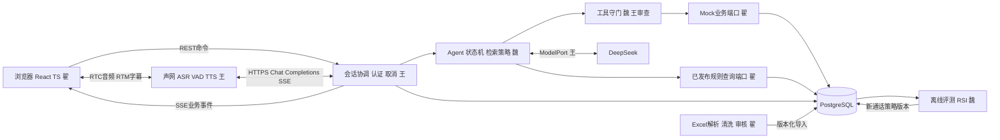

# 架构与语音链路

浏览器获取授权session和短期RTC／RTM凭证，加入频道并订阅字幕后请求start；后端创建云Agent主动开场。声网将最终ASR文本送后端，魏的Agent处理文本及事件。普通HTTP控制与SSE业务推送由FastAPI负责，音频不经FastAPI。各后端模块优先函数调用。

语音字幕只用RTM工具包；业务状态、驳回结果、预约与指标来自后端SSE。文本模拟模式只用SSE文本，不同时显示两套字幕。前端不能从“已经帮您处理”推测写操作成功。

历史由SessionCoordinator维护。声网请求只抽取当前最终user输入，用binding_id＋provider_turn_id去重；不把声网历史整体与数据库历史重复拼接。模型上下文为已脱敏消息＋当前申请单事实＋已发布规则，服务器设置system prompt。ASR partial不触发业务，重复文本不同轮可合法存在。

每轮分session_id、turn_id、generation_id，业务动作使用独立operation_id。打断时：云端停播放；客户端上报目标轮次；协调器提升generation_epoch并关闭上游模型stream；旧chunk和查询结果丢弃。新的最终输入同时使旧生成失效。客户端打断遥测不能作为身份／同意证明；实时打断与Webhook覆盖不同，不依赖Webhook保证实时取消。

已派发驳回／预约操作不随生成取消撤销；仍保存实际结果并查证。被打断回复保留generated_text、played_text和playback_status；播放范围未知就标unknown，不把全文视为已听到。通话拒绝仅停止交互，不删除既定审核事实；错误接听人不得被当作商家拒绝。

部署：固定公网HTTPS域名，反向代理关闭SSE缓冲；禁止用localhost测试代替云回调成功，不依赖现场外网穿透。自定义URL带session路径、独立短期Bearer密钥与绑定校验；管理声网凭证不下发浏览器。国内API区域使用控制台对应的/cn/配置，不混用国际或Preview参数。退出调用leave，关闭页后扫描清理遗留Agent，操作pending从DB恢复。

安全：同源HttpOnly Cookie＋CSRF／Origin检查、每个session按owner授权、密钥服务端保存、Webhook验签和noticeId去重、日志入库及上传前脱敏。录音默认关闭；确需录制时文件置私有存储，DB仅留URI/hash/用途/有效期。官方资料能否传外部云模型需确认授权范围。
