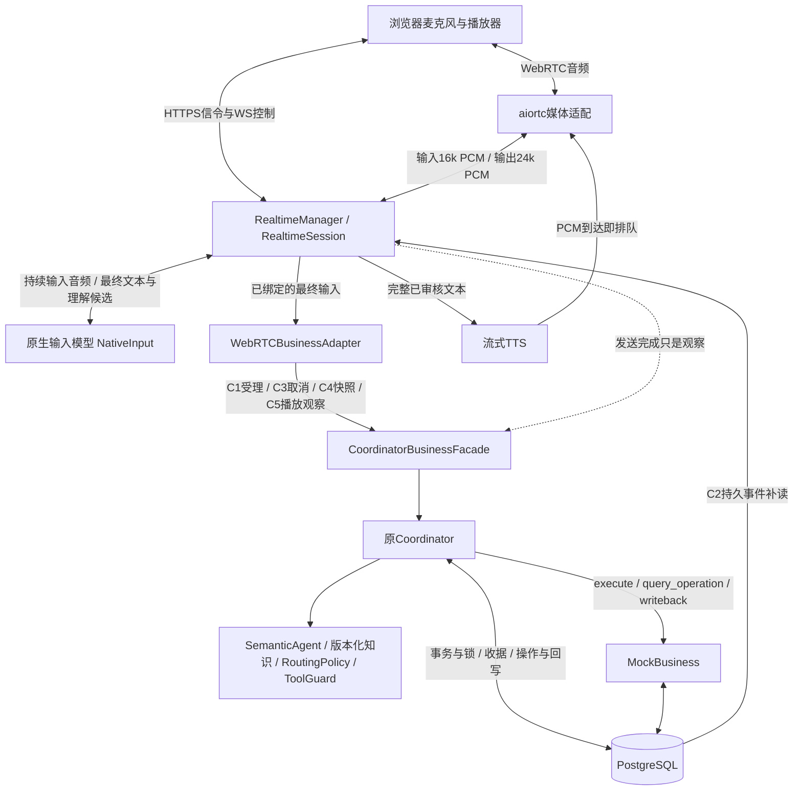

# V0.4 双 PR 整合、数据流与赛题验收

日期：2026-11-24。验收基于仓库 `docs/design/01-requirements.md`、`08-evaluation-rsi.md` 和已冻结的0.4.0契约。未获得新的官方测量工具或规则，因此不能将工程验证等同官方评分。

## 合入内容与实际修复

- 公共起点：`657310e74b6ef19bd3ecaa9fd0cd4afda159225b`。
- PR #8：`0be1a82305e6493a2c9432df4f4dd6ca62fd2f05`，业务门面、持久事件、候选复用、恢复及七类共享替身。
- PR #7：`cbd24808107b7c0237234b015c44d86464a84c59`，WebRTC、模型接收、流式TTS、播放仲裁、取消和资源清理。
- 整合分支：`codex/v04-integration-20261124`，独立worktree；没有覆盖原工作区的未提交实验代码。

直接合并有一个Coordinator受理冲突，且存在三个运行期缺口：媒体随机绑定没有登记到业务库；最终模型输入没有调用record_input；CASE_READY无法经合法入口开场。解决冲突时保留admission校验，同时保留对旧接口的native_webrtc拒绝，不能通过放开旧输入绕过业务端口。

新增 `WebRTCBusinessAdapter`，由默认create_app注入同一个Coordinator：协商前生成业务绑定；最终模型输入登记后提交；浏览器和媒体就绪后以服务端OpeningAdmission启动开场。开场不写成用户消息，受理和待执行任务同事务提交；重连不重播开场。恢复循环与Coordinator使用同一宿主生命周期。

实时审核答案直接交付，不再走FakeModel的模拟逐字sleep，不额外调用回答模型。真实门面仍在完整答案审核后交付一个片段，尚未实现生产业务多片段提前播报。

## 当前架构与数据如何流动

这是单进程、单worker的模块化系统，并行依靠asyncio任务。媒体、业务端口和持久化有清晰边界，尚不支持多实例共享内存连接、取消器和任务队列。当前实时入口同时只允许1通会话。



1. 浏览器先登录，选择合成申请，创建 `mode=voice, voice_transport=native_webrtc` 会话。服务端检查开关、申请白名单和供应商配置；创建时仍为CASE_READY，不假定已经核验或告知。新模式默认关闭。
2. HTTPS交换ICE及SDP，媒体与业务使用同一服务器生成的connection_binding。WS只传ready、心跳、打断和播放观察，不接收客户端伪造的业务答案或可信上下文。音频走WebRTC。
3. 两端就绪后，服务端创建独立开场generation，进入VERIFYING。只询问公司/店铺身份；没有把`__opening__`伪造成用户原话。恢复已有会话时跳过历史开场。
4. 媒体连续读取音轨，转16kHz PCM16单声道输入模型。模型事件独立接收，通过item/response/epoch关联最终文本和理解候选。自由模型音频不会进入播放器。候选只供业务决策参考，身份、申请和执行权限仍由服务器重验。
5. 适配器登记本轮输入证据，再进入C1。业务门面重验owner、绑定有效期、请求幂等、供应商输入唯一性、state_revision、case_revision和knowledge_version。持久登记后返回AcceptedTurn，不等待完整答案或工具执行。
6. Coordinator建立可信上下文；SemanticAgent校验候选原文与允许槽位，复用原生理解结果，避免再次调用独立理解模型。规则、已审核知识和ToolGuard约束披露、状态迁移及操作。合成身份规则只支持指定演示主体，不能当作真实商家认证。
7. 权威状态与旧事件、v0.4投影事件同事务提交。C2按会话递增seq补读；普通text.delta不获得播放权。当前真实业务发布一个完整审核片段，包含generation、message、segment和文本SHA256。
8. 实时层匹配generation和片段顺序，去重后交给唯一播放消费者。TTS音频一到即写入有界PCM队列，浏览器确认旧RTP已排空后放行。输出240ms、输入500ms是队列上限，不是回答延迟。
9. 打断先静音并清旧队列，提升epoch、取消合成，再通知C3。过期答案不得重新播放。已经登记派发的operation_id继续查证和回写，不能把取消生成当撤销外部操作。
10. 数据库为恢复依据：C4快照含状态、版本、generation和C2游标；重连从游标后补读，不重播历史音频、不重复派发。排队任务可恢复；进程运行中断的生成明确失败，不能宣称自动续跑。操作按持久账本恢复。

三种ID各司其职：request_id用于请求去重；generation_id/epoch隔离当前答案和音频；operation_id用于业务事实查证。业务成功与writeback.completed分别记录。

## 新语音链路的真实边界

本地接线测试已经跑通主动开场和三轮输入：核验身份→回答原因与整改→回答“必过吗”→接收“明白了”。这里使用真实Coordinator、Agent和PostgreSQL，以及受控模型/语音边界。

由于C5只有音频发送观察，核验后的原因说明不会写成completed NotificationEvidence。因此保证类追问后仍是EXPLAINING，不能因文本生成完成就冒认已告知。第三轮提出业务动作时，写入开关和可信告知守卫将其转MANUAL_REVIEW，business_effects仍为0。这是安全降级通过，也是新路径尚未完成业务闭环的明确证据。

旧文本流程则完成CLOSED、一次Mock操作、一次效果和回写。业务门面的独立文本闭环也有回归覆盖。二者不能拼接为“WebRTC完整语音闭环已通过”。当前默认proof resolver拒绝客户端证据；没有把发送完成或浏览器completed升级为业务授权。

## 本次执行的验证

所有数据库操作均在全新本机 `zhiyu_v04_integration_test`、PostgreSQL 18.7上进行；没有连接线上数据库、调用云模型、部署、扩大额度或启用语音写入。

| 验证 | 本次结果与证明范围 |
| --- | --- |
| 0001→0004真实数据库迁移 | 通过；新增realtime_events，保留原事件和操作账本 |
| 合并及接线修复后的完整后端 | 483 passed，0 skipped；含8项新增跨模块测试，一条现有Starlette/httpx弃用提示 |
| 随后补充协商绑定的定向复验 | 9 passed：七场景、真实业务三轮、协商绑定/重绑定；与上述8项重叠，不相加宣称492项 |
| 七类共享替身接实际RealtimeSession | 正常、慢任务、重复、超时未知、迟到、打断、断线恢复均通过；慢任务时收音继续，旧generation不播、重复片段不重播 |
| 真实业务接实际RealtimeSession | 开场、三轮、候选复用、审核输出、无凭据禁写通过；模型和媒体使用受控边界 |
| Schema/OpenAPI/TypeScript | 从源生成，v0.4 Schema一致性及前端typecheck通过 |
| 前端生产构建 | Webpack构建通过；本地复用node_modules链接，默认Turbopack构建由正常npm ci的CI验证 |
| 真实Chromium/aiortc | 20次本机建连/清理通过；按钮与自动插话观察通过；供应商及业务端使用测试边界 |
| 浏览器文本回归 | 2 passed；登录、三轮、回写、刷新恢复和事实展示通过 |
| 文本链路数据库事实 | 1会话、7消息、63事件、1操作、1效果、1条回写；事件连续、操作succeeded、状态CLOSED |

20次媒体循环不等于20次插话。该浏览器脚本只有按钮和自动插话各1个停止样本，分别约256.3ms和220.1ms，不能得出P95≤300ms的统计验收。其测试边界首音频约278.8/280.3ms也不能充当真实模型业务P50。原始本机结果位于忽略目录`.cache/`；脱敏摘要见同名JSON。

七类共享替身的disconnect用例验证完成后的快照恢复、不重播和唯一效果；不能证明媒体在外部派发中断线或真实进程崩溃。业务侧已有持久队列、超时查证和操作期间取消/断线测试，实际服务进程kill/restart仍需另验。

初次完整回归有两项临时目录权限错误；改用仓库外专用basetemp后，上述完整回归483项通过。初次新链路测试错误地期待生成后自动进入QA；根据无可信告知不得推进的约束修正了断言，没有放宽守卫。

## 对照赛题要求

| 要求 | 当前判定 | 依据与缺口 |
| --- | --- | --- |
| ≥3轮实时语音、AI主动开场 | 部分达到 | 离线编排三轮、真实RTC分别通过；尚无本轮真实供应商+业务+媒体共同三轮验收 |
| 用户说完至有效回答P50≤2秒 | 未验收 | 本轮无真实供应商样本；v0.4按更严格P50<2000ms验收；240ms队列不能代替此指标 |
| 打断与持续输入 | 结构通过、真实质量未验收 | 收音/事件/合成独立、epoch隔离、真实本机媒体冒烟通过；插话样本不足，噪声、双讲未测 |
| 身份核验前不披露、拒绝/错人停止 | 合成回归通过 | 沿用服务端守卫；真实语音识别误判及业务身份认证未验收 |
| 原因、整改、不能承诺必过、规则冲突 | 已审合成范围通过 | 来源与版本受约束，冲突转人工；不能推广成全部68场景均可自动回答 |
| 电话/京麦、三类授权、回电等边界 | 已有实现回归通过 | 本轮未重导原始赛题或重新审核私有知识包；预约/人工仅状态升级，没有外部工单 |
| 幂等、超时查证、回写与恢复 | 文本/业务模块通过，语音闭环未通过 | 唯一效果与持久回写有证据；WebRTC可信播放和语音动作授权尚未接通 |
| RSI归因、候选、评测、采纳/拒绝/回滚 | 机制回归通过、真实改善未验收 | 不能以现有门控单测代替本轮真实语音候选的提升与回滚实验 |
| 真实环境鲁棒性和可部署性 | 未验收 | 没有公网TURN/弱网/断网及部署测试；Compose文件存在不等于公网媒体可通 |

**结论：两模块可以合入；新数据流与关键安全约束已完成离线整合验证。当前仍未满足全部赛题验收，不应宣布语音完整闭环、真实时延或RSI改善达标，不应开启新模式业务写入。**

## 按优先级改进

1. **P0：定义并接入独立可信播放证据。** 证据解析必须绑定owner/session/connection/generation/message/segment/hash/case_revision，覆盖完整原因与整改。中断、缺段、陈旧版本、伪造客户端completed均不得授权。通过后将完整告知接入原NotificationEvidence和ToolGuard，再单独验Mock语音操作、确认结果、版本化回写与CLOSED。不能直接把RTP发送完成当商家已听到。
2. **P0：做真实供应商共同链路和同条件测量。** 先验证真实模型事件顺序、槽位、输入证据关联和多轮理解，不让模型自述授权。固定代码、知识、输入音频、案例、网络、客户端和配置，旧/新方案各至少30个有效业务轮次；报告全部失败/缺失、任务成功率、成本、P50/P95，使用官方口径复测。硬门槛<2秒、P95不超同条件基线110%、失败率不增加。两种插话各扩充样本，另做噪声与双讲；团队完整语音计划为30通≥90轮及20次插话。
3. **P1：消除事件循环中的同步数据库等待。** 门面、事件轮询和Coordinator仍直接执行同步SQLAlchemy事务；async def并不能使SQL并行。遇锁等待/慢库时会阻塞收音、事件与打断。应将完整短事务移到专用受限线程/异步数据库适配中，模型任务调度和asyncio取消留在所属循环；增加真实锁等待注入、loop lag、音频丢帧和取消延迟验收。不能仅把外层async包装视为解决。
4. **P1：验证真正的生产片段收益。** 当前真实门面只在完整审核后发一个片段；七类Mock的双段并不代表生产提前播报。将身份问句、独立完整的原因/整改等安全语义单元按顺序审核发布，避免先播承诺后纠正。测清输入确定、业务决策、审核、TTS首PCM、远端有效答案的分项时间，再决定缓存或分段，不增加强制第二模型。
5. **P1：完成TURN及恢复故障验收。** Caddy的443/WS不能代替WebRTC媒体中继；部署临时TURN凭据，验证公网NAT/容器、弱网、媒体断线、控制断线、工具派发期间断线及服务进程kill/restart。最终仍须1次业务效果和连续事件/可恢复回写。保持单worker限制直到共享任务所有权和取消路由有实际设计。
6. **P2：扩充已审业务与真实RSI。** 将68条待审/已导入与已支持场景清晰区分，逐批发布知识版本；完善预约/人工真实工单或保持明确模拟。冻结开发/保留集、模型和案例，做真实语音回归后再判定候选采纳；没有可复现收益应拒绝采纳。

## 复现与回滚

仅对自己新建、已迁移至0004、名称以`_test`结尾的数据库设置DATABASE_URL、APP_ENV=test、RUN_DB_TESTS=1、PYTHONPATH=backend。测试会清空该库的业务表。

```text
python -m alembic -c backend/alembic.ini upgrade head
python -m pytest backend/tests -q
python scripts/export_contracts.py
python scripts/export_realtime_contract.py --check
npm run types --prefix frontend
npm run typecheck --prefix frontend
npm run build --prefix frontend
node scripts/verify_realtime_browser.cjs
python scripts/verify_browser_flow.py
```

Windows若默认pytest临时目录权限异常，用仓库外的新basetemp；私有资料转换器有意拒绝把其测试输出写入checkout普通目录。浏览器脚本需Chromium缓存和正确REALTIME_TEST_PYTHON。基础CI含真实数据库；可选实时CI安装aiortc并运行媒体/浏览器和七类共同场景。

回滚/暂不启用：保持REALTIME_WEBRTC_ENABLED=false、VOICE_WRITES_ENABLED=false，旧agora/文本路径仍可使用。需要试验时显式配置白名单、供应商额度、RTC依赖及ICE；本轮没有扩大或清零额度。不要删除数据库、事件、操作或回写账本，也不要执行down -v。
