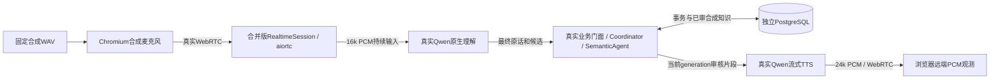

# 合并基线真实语音测量与最小协议修正候选

日期：2026-11-24，候选采样时间为北京时间17:52:28—18:02:20。任务是定位用户说完至有效业务答案首音频的耗时，不进行架构重写、部署或业务写入。

## 结论与版本边界

**原 main 的真实联调发现输入槽位契约冲突，无法直接给出其30轮有效回答P50。在隔离分支仅收紧原生理解提示词、保持原业务守卫后，完成30个有效轮次：P50为1621.3ms，P95为2128.6ms。**

候选共11通、31轮尝试，30轮有效，1轮在TTS阶段约5秒未取得首PCM后失败。有效回答率为30/31=96.77%。28轮低于2000ms，占全部31次尝试的90.32%；P50低于2秒不代表每轮均低于2秒。

将失败视为本次截止时间内没有有效答案、保留在请求分母中，31次尝试的P50为1642.1ms、P95为2182.0ms。这个指标与只对30轮有效回答计算的分位数分别列出，不删除失败、不将其记为0。

这证明当前已升级的并发链路，在本机媒体回环及真实云供应商条件下，经过最小契约修正可以达到绝对P50门槛。**不能称为未修改main已达标，不能推广为公网、弱网、并发负载或完整语音业务闭环已验收。**

- 合并基线：`ecefd4b027fcfce71a6d43083980417faa8f4a1b`。
- 本地评测分支：`codex/v04-real-latency-20261124`。
- 原版本诊断运行：`v04-latency-20261124-a`。
- 最小修正候选运行：`v04-latency-20261124-b`，不与原版本混算。
- 唯一生产文件变动：`backend/app/realtime/provider.py`中的理解提示词，要求顶层字段固定，slots只允许callback_time/callback_window/timezone，非回电意图slots为空；禁止identity_claim/company_name等额外槽位。没有过滤掉不合格候选，也没有放宽业务校验。
- 候选provider文件SHA256：`3948662f4c8fcf44ac494cda31ac2b70d8754c9270d9b941e2f6a97c1daa66e7`。
- 没有修改VAD 400ms、模型、TTS、超时、播放队列、状态机或媒体处理；没有新增第二个理解模型。
- 修正及测量脚本只保存在本地分支，未发布main、未部署公网。

## 实际测试的数据流

媒体、供应商和业务代码沿用合并实现。测量宿主使用子类/包装器添加时间戳和独立运行账本；浏览器加载交付的RealtimeVoice源码及AudioWorklet。没有用假模型事件、伪造首音频或测试音调代替真实供应商。

`MODEL_PROVIDER=fake`只用于关闭旧通用回答模型；此新路径的输入理解仍调用真实`qwen3.8-omni-flash-realtime`，已审核答案按现有实现确定性输出，再调用真实`qwen-audio-3.1-tts-flash`。不能将这个配置误读为本轮使用Fake理解。

业务使用synthetic申请1及demo-k1已审知识。三轮分别核验身份、问是否保证通过、问审核依据；不提出驳回等写动作。所有样本核对业务效果数为0；结束后13个诊断/候选会话处于CLOSING，不是完整业务关单CLOSED。

## 固定的条件与音频

| 条件 | 本次固定值 |
| --- | --- |
| 浏览器 | Chromium headless shell 159.0.8154.6，Playwright浏览器revision 1255 |
| 网络 | 同一Windows主机，Chromium↔aiortc为127.0.0.1回环；两项真实供应商调用走同一主机至北京地域的外网；没有TURN |
| 原生输入 | qwen3.8-omni-flash-realtime，text-only理解，max_tokens=512，server_vad threshold=0.5，silence_duration_ms=400 |
| TTS | qwen-audio-3.1-tts-flash，longanhuan_v3.1，24kHz PCM16 |
| 输入 | 固定的单声道PCM16合成WAV，原文件24kHz，经浏览器及生产媒体适配重采样输入 |
| 业务限制 | 相同synthetic申请、知识、身份规则与禁止语音业务写入；开场不计入答复延迟 |
| 负载 | 单通顺序采样，不代表多通并发容量；固定顺序为身份→必过追问→来源追问 |

| 案例 | 文件 | 时长 | 最后有声块结束 |
| --- | --- | --- | --- |
| identity | merchant-1.trimmed.wav | 1920ms | 1870ms |
| guarantee | merchant-2.trimmed.wav | 1640ms | 见脱敏JSON中的固定音频元数据 |
| source | merchant-source.trimmed.wav | 2080ms | 见脱敏JSON中的固定音频元数据 |

音频集SHA256：`d071d54bca089bca6550e1690ac724888171a7102d69834af37f4408408315e0`。每个文件的SHA256和最后有声块时间见同名JSON；不将原音频提交到仓库。

## 测量口径与误差

主指标：**固定输入最后一个RMS>0.004的10ms音频块结束，到浏览器观测到当前generation、answer=true的远端非静音PCM。** 输入结束用AudioContext预定播放映射到performance时钟；输出用交付的AudioWorklet与播放许可观测。额外保存WAV完整结束至首音频时间，避免静音尾部缩短指标。

等待话术answer=false与开场不计入。仅在身份/意图和业务答案检查通过时，将该轮记为有效；不能仅以收到声音判成功。保证类回答必须含不能保证/不能承诺等约束；来源类回答须具有依据/来源说明。

每轮取7次本机时钟往返采样中最小RTT估计服务端与浏览器的偏移。最小RTT中位数1.1ms、P95为1.7ms，但RTT/2不是严格误差上界。服务端Python的monotonic在本机使用GetTickCount64，分辨率15.625ms；浏览器音频图和20ms RMS观测也有量化误差。很短的业务纯决策被计为0时，表示低于服务端计时分辨率，不表示没有工作。

端到端主指标使用同一浏览器时钟；分阶段跨端时间用偏移估计，不能当作微秒精确的供应商内部耗时。结束检测一项包含输入传输、VAD和事件返回，无法分别测出云内纯VAD计算。

## 最终分布

| 指标 | n | P50 | P95 |
| --- | --- | --- | --- |
| 有效业务答案首音频 | 30 | **1621.3ms** | **2128.6ms** |
| 全部请求，失败视为没有有效答案 | 31 | 1642.1ms | 2182.0ms |
| 身份核验轮有效首音频 | 10 | 1621.3ms | 1820.5ms |
| 保证类追问有效首音频 | 10 | 1607.5ms | 1982.0ms |
| 来源追问有效首音频 | 10 | 1659.8ms | 2182.0ms |

有效样本范围1520.3—2182.0ms。分位数使用nearest-rank。30样本是工程初筛，不是广泛场景或统计稳定性保证；本轮没有运行同条件旧方案，不声称相对提速比例或P95相对门槛通过。

| 阶段 | P50 | P95 | 解释 |
| --- | --- | --- | --- |
| 输入传输＋结束检测＋返回 | 584ms | 657ms | 包含400ms静音判停配置和网络/媒体开销 |
| 停止事件→原生理解完成 | 468ms | 828ms | 包含模型输出JSON及传输，真实长尾来源之一 |
| 最终输入→业务审核片段收到 | 32ms | 62ms | 含持久受理、决策、提交与事件补读 |
| 审核片段→开始合成 | <16ms | 约<16ms | 无额外通用回答模型；受时钟分辨率限制 |
| 合成开始→首PCM | 313ms | 515ms | 包含本轮调用登记和真实TTS网络/服务耗时 |
| 首PCM→浏览器有效音频观测 | 227ms | 261ms | 包含媒体发送、缓冲、播放门控及观测 |

业务受理自身P50约15ms、P95约16ms，包含在业务审核阶段内，不重复相加。**各阶段P50不可相加来推算总P50。** 已对30个有效样本逐个核对六阶段时间闭合、审核片段与generation匹配、文本一致及业务效果为0，全部通过。

## 失败、校准与修正记录

1. 原版本诊断第1通：供应商没有返回结束事件，16秒观察窗内无有效回答。当时合成麦克风未设置持续静音源，疑似影响判停；随后增加持续零增益源和输入帧心跳，观察到持续静音和结束事件。这是测量校准阶段，不能据此认定生产VAD故障；该失败保留，未算作有效回答。
2. 原版本诊断第2通：真实模型返回`identity_claim`槽位；业务只允许回电槽位，报INVALID_INPUT。没有让身份槽位通过，也没有将其静默删掉。这是实际模型与提示词/业务契约不一致的缺口。
3. 候选只修正上述提示词后，第一次身份输入已被真实业务受理并生成审核片段，但TTS约5秒内无首PCM，最终REALTIME_TASK_FAILED；该首轮尚未加入细分TTS错误记录，所以报告按已观察到的阶段描述，不伪称有完整上游错误码。
4. 随后继续相同候选和固定输入，取得30个有效轮次；未放宽TTS首音频超时、未添加自动供应商重试、未改变业务守卫，未删除上述失败。

## 瓶颈判断与下一步

1. **当前单通正常回答的业务模块不是主要瓶颈。** 32ms业务审核远小于输入结束链路584ms、原生理解468ms及TTS313ms；目前无需先做服务拆分来解释这轮延迟。慢数据库和并发负载仍需另外验证，不能由本轮否定它们的风险。
2. **优先对结束检测做受控对照。** 在固定样本上比较400ms与更低阈值，但同时测试句中停顿、噪声和误切；本轮没有更改VAD来取得结果。
3. **关注理解与TTS的长尾。** 来源追问出现2182ms；原生理解P95为828ms、TTS首PCM P95为515ms，并有一次TTS阶段失败。应增加长时采样，保留请求ID和细分错误码，再决定提示词输出精简、供应商适配或输出方案对照。
4. **复验真实公网媒体。** 本轮浏览器至网关是回环；部署当前候选到受控环境后，需在目标客户端、TURN/公网路径复测，不把本地P50直接标成公网达标。
5. **原生语音输出可作为下一组候选。** 复用当前WebRTC、业务守卫、取消及播放框架，与本轮受控TTS路径同条件比较；不以尚未测试的方案承诺提速。

可信播放完成、业务操作和回写闭环没有在本轮验收；本轮只有浏览器解码PCM观测，不是物理扬声器或商家已听到的可信证据。无同条件旧方案，完整性能门控保持未通过，只有候选绝对P50<2000ms这一项有本次样本证据。

## 用量、证据与复现

候选实际11次原生会话、31份模型usage响应、10062个总token（输入8823、输出1239）；42次TTS尝试，包含11段开场和31轮答案尝试。原生轮次账本预占33，和实际31次响应不是同一口径。金额与账号余额未估算。原诊断运行另有2通，不混入候选用量。

所有调用在新建的本机`zhiyu_v04_latency_test`及独立run账本中记录，未清零原有账本、未改长期.env、未开启语音业务写入。评测结束停止专用宿主及数据库，保留数据和文件。

- 原始脱敏前诊断：`.cache/v04-latency-20261124-a.json`。
- 逐轮真实候选证据：`.cache/v04-latency-20261124-b.json`，含当前generation、原话/候选、审核文本、浏览器和服务器时间线、失败及用量；仅合成资料，仍保留在忽略目录。
- 可分享的统计与版本边界：[v04-real-latency-20261124.json](v04-real-latency-20261124.json)。
- 宿主：`scripts/measure_realtime_app.py`，只监听本机，由私有评测令牌保护观测接口。
- 浏览器驱动：`scripts/measure_realtime_browser.cjs --run-real-latency`，需配置LATENCY_RUN_ID/LATENCY_CONTROL_TOKEN，复用既有合成音频；达到30个有效样本停止，并保留之前失败。
- 汇总：`python scripts/summarize_realtime_measurement.py .cache/v04-latency-20261124-b.json --output .cache/v04-latency-20261124-b-summary.json`。

协议修正的离线定向回归24项通过。测量未修改生产媒体/业务算法；不会拿离线回归替代上述真实测量，也不会把不同版本的两轮数据拼成相对提速结论。
