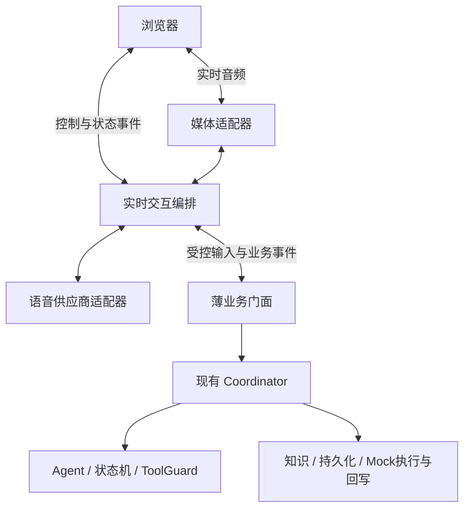

# V0.4 实时交互与业务封装升级契约

日期：2026-11-24。状态：开发契约草案；五类接口为逻辑接口，尚未全部实现；性能门槛为建议值，双方在 PR0 中确认后冻结。

PR0增量：五类接口现已有Pydantic DTO、Python Protocol、事件/错误码与生成Schema定义，详见[公共契约0.4.0](design/contracts/realtime-v04.md)。本轮仅完成公共契约，不包含替身、业务实现或媒体接线；以下设计示意字段以该落地契约为准，例如事件游标统一使用seq、版本拆分为state_revision/case_revision。

## 1. 首要目标与基线

首要目标是在保留业务正确性的前提下，缩短用户说完话到有效业务回答开始的时间，并支持及时打断。不能仅将传统 ASR → LLM/Agent 理解 → TTS 串行链路重新封装，再宣称升级完成。

目标是让音频输入、模型事件接收、业务任务和音频输出并行运行，将必须串行的部分限制在输入证据绑定、权限校验、业务事实依赖、状态提交和操作结果确认上。并行不要求微服务或消息中间件。

本次只读检查的本地起点：分支 `codex/native-realtime-evaluation`，HEAD `3fd69fe`。检查时存在未提交修改：`backend/app/config.py`、`contracts.py`、`coordinator.py`；另有未跟踪的 `backend/app/webrtc_media.py`。这些是开发中资产，不能清空、覆盖或计入已提交基线。PR0 应记录完整 commit、改动归属及双方实际起点，本段不是实时工作区快照。

历史数据来自本地实验分支的 `docs/native-standard-closure-20261123.md`：1通、5轮合成输入，浏览器首个非静音远端 PCM 的 P50 为 2840.2ms、P95 为 2939.7ms；不是物理扬声器校准结果，也不能与其他不同条件实验直接比较。该报告及对应实验代码不随本次文档发布自动进入 main；本文没有新增真实运行或性能结果。

发布范围：本次仅向 GitHub main 发布本契约及设计入口。远端 main 的 README 仍描述较早的0.3基线，本地实验HEAD未能通过GitHub比较接口解析，不能把上述本地模块、未提交实现或历史验收当作云端已交付能力。开始功能开发前必须选择并冻结实际代码基线；需要复用本地实验成果时，逐项审查后另提代码PR，不整批推入main。

## 2. 模块边界与并行规则

- 实时模块负责音频、VAD/轮次、供应商协议、任务超时、打断、播放仲裁和过期结果隔离，不直接授权或执行业务。
- 业务模块负责输入校验、身份核验、知识约束、状态迁移、幂等操作、查证和回写，不依赖浏览器或音频 SDK。
- 使用进程内接口与依赖注入，优先复用 `ports.py`、现有 DTO 和事件；不为模块封装增加一次网络往返。
- 接收音频、接收模型事件的循环不得等待完整业务任务。后台任务须有上限、取消、异常收集和会话退出清理，不能无限创建任务。
- 原生模型已有可用理解候选时，校验后复用；不能无条件再调用另一理解模型。候选不合格时按显式规则澄清、兜底或重试并记录耗时。
- ASR、理解模型、TTS 是可替换能力，不要求每轮固定经过全部组件。工具调用也不应成为无业务轮次的额外强制等待。
- 连接建立、绑定版本的知识预加载、固定审核话术音频缓存可以提前准备；缓存不能替代权限和当前版本重验。
- 未校验业务内容不能先播后审。允许独立审核的完整语义片段先交付，与后续处理重叠。

## 3. 五条公共契约

以下名称用于讨论，PR0 需要给出与现有 `AcceptedTurn`、`TurnInput`、`SessionContext` 和持久事件的字段映射。优先适配现有接口，不建立第二套同义状态。业务逻辑不自行信任浏览器或模型传来的 owner/source 等字段。

### C1：轮次提交与快速受理

逻辑签名：`submit_turn(TrustedTurnContext, BusinessTurnInput) -> AcceptedTurn`。

可信上下文由服务器生成或验证：owner、session_id、request_id、provider 输入轮次、预期业务版本及连接绑定。输入包括绑定本轮的最终文本和可选理解候选；候选不得携带 verified、允许操作、成功等授权结论。

临时转录或未完成候选只能触发可取消的预取和准备，不能授权、推进权威业务状态或派发操作。第一版可不实现临时输入；不能把它列为已完成能力。

受理仅完成必要鉴权、幂等检查、持久登记和任务启动，不等待完整理解、答案或业务操作。复用 `AcceptedTurn` 的 turn_id/generation_id。相同 request_id 与相同内容重试返回同一结果，相同编号与不同内容冲突。原始输入证据与归一化处理须有明确绑定，模型改写文本不能冒充独立用户证据。

内部 accepted 不代表供应商工具结果成功；实时编排按供应商真实协议等待并提交正确结果，不阻塞事件接收循环。

验收：让 Fake 业务任务等待3秒，受理不等待这3秒，音频与模型事件仍持续被消费；重复请求不产生新业务效果。

### C2：业务事件与可播放内容

逻辑签名：`subscribe_events(TrustedSessionContext, after_sequence) -> AsyncIterator[BusinessEvent]`。

事件公共字段：event_id、会话内递增 sequence、session_id、turn_id、generation_id、type、payload。操作事件关联 operation_id。事件在事务提交后才对外生效；消费者按序号去重、补读。

| 逻辑语义 | 内容与处理 |
| --- | --- |
| reply.segment_ready | 已审核、允许播放的完整语义片段，绑定 segment_id/index 和 speech_policy |
| reply.completed | 本轮答案内容结束，不等于音频播放完成 |
| operation.updated | 操作处理中、成功、失败或未知，不与答案生成状态混用 |
| turn.failed | 本轮无法继续，携带稳定错误码和重试属性 |
| writeback.completed | 回写完成，与操作成功分别表达 |

这些是待映射语义，不要求全部新增同名事件。普通 token 增量不自动获得播放权限。`speech_policy=verbatim` 表示按审核文本播报，第一版可统一采用该策略。分段必须语义独立，不能先播成功承诺，再由后续片段纠正。片段顺序、最大大小、订阅上限、慢消费者退出和补读保留范围在 PR0 固定。

数据库持久事件仍为恢复依据。先复用现有读取；如果增加内存通知，采用提交后通知、序号补读，验证首次订阅竞争和通知丢失，不默认跨 worker 可用。

验收：两段已审核测试答案中，第一段在第二段就绪前可开始播放；重复事件不重复播放，断线补读不漏事件。生产分段安全与收益另验收。

### C3：打断、取消与旧结果隔离

逻辑签名：`interrupt_generation(TrustedSessionContext, generation_id, request_id) -> InterruptResult`。

实时模块先停止本地输出并清空旧音频，再协调业务侧取消，不等待远端确认才静音。业务模块在耗时步骤及提交前检查取消和 generation 有效性。音频、片段和任务结果均绑定 generation；旧结果保留必要审计但不重新进入当前播放队列。

打断幂等。已登记派发的业务操作继续查证和回写，不能把取消协程等同于外部操作撤销。同一会话权威业务状态更新有序，结合锁、版本检查和幂等实现。

验收：理解中、生成中、播放中、操作派发后分别打断，无旧音频恢复、无重复操作、无操作记录丢失；慢工具期间仍可接收打断事件。

### C4：状态快照与恢复

逻辑签名：`get_snapshot(TrustedSessionContext) -> BusinessSnapshot`。

快照包含业务状态、状态版本、当前 generation、最新事件序号、操作状态和可用的答案/播放摘要。数据库为业务状态权威来源。重连按快照与事件补读恢复，不自动重播历史答案或重新派发操作。

连接断开不代表操作失败。旧版本明确拒绝，调用方刷新后重新判断。PR0 必须约定快照与事件游标的一致性读取方式、会话归属和 worker 限制；进程内任务不能宣称重启后自动恢复，重启后的未知操作由既有查证机制处理。

验收：操作派发后断线，重连可取得最终状态，业务效果仍只有一次；分别覆盖媒体断线与进程重启，后者不能用前者测试替代。

### C5：播放仲裁、证据与性能观测

逻辑签名：`report_playback(TrustedSessionContext, PlaybackReport) -> PlaybackReportResult`。

等待反馈、原生模型音频、确定性 TTS 共用一个播放仲裁器，不能同时抢占输出。报告绑定 generation、segment 和播放实例。区分客户端观察与服务端验证的业务播放证据；新 WebRTC 路径必须定义证据来源，不能直接继承旧声网路径的验收结论。

被打断或证据不足不能将完整内容记为已告知。播放器收到数据、play()、SDK完成事件、模型完成或客户端声明均不能单独授权业务状态推进。非业务等待反馈延迟单列，不能计作有效答案。

统一 trace 关联 session/turn/generation/request/operation/方案版本；记录用户说完、输入确定、理解候选、业务决策、审核片段就绪、调度、首音频、有效答案开始、打断与停止、操作结果及回写。各时钟域分别计时，不能相减独立单调时钟。报告缺失、失败和超时，不仅报告成功样本。

验收：伪造客户端完成报告不能推进业务；中断片段不能错误形成完整告知；等待反馈与有效答案分别统计。

## 4. GitHub 双人分工与合并顺序

| 责任 | A：实时交互负责人 | B：业务封装负责人 |
| --- | --- | --- |
| 文件归属 | 媒体、供应商适配、实时编排、VoicePanel、语音测试 | 业务门面、Coordinator局部适配、业务事件、状态/幂等/回写测试 |
| 独立开发 | Mock业务：可配置延迟、超时、失败、重复、乱序及迟到结果 | Fake实时消费者：文本提交、订阅、取消、重连 |
| 测试责任 | 持续收音与收事件、任务上限、播放、背压、打断、清理 | 鉴权、输入证据、版本、状态机、操作查证、去重、回写 |
| 共同验收 | 完整闭环、有效回答延迟、播放证据、故障恢复 | 完整闭环、有效回答延迟、播放证据、故障恢复 |

公共文件 `ports.py`、`contracts.py`、`main.py`、配置及生成类型由 A 负责最终整合；B 通过小 PR 提交变更。协议从 Pydantic 源生成，不手改生成文件。具体人员名字由团队在 PR0 填入。

| Issue / PR分支 | 交付 | 合并门槛 |
| --- | --- | --- |
| PR0 `codex/v04-contract` | 本文、DTO映射、错误码、四类时序示例、替身接口、测量定义、基线和归属 | 双方确认接口、输入可信边界、播放证据和未决项；接口文档可被双方使用 |
| PR1 `codex/v04-business` | 薄业务门面、持久事件适配、文本独立运行 | Fake消费者通过C1—C5的业务侧验收及相关回归 |
| PR2 `codex/v04-realtime` | 实时编排、媒体、播放和打断 | Mock业务通过并行、取消、背压、断线清理验收 |
| PR3 `codex/v04-integration` | 完整接线、测量报告、运行配置和回滚说明 | 完整Mock闭环、安全回归、性能对照与共同评审 |

PR1/PR2在PR0后并行。新契约变更先提交小型契约PR，明确兼容策略，再调整实现；不能在功能分支中悄悄改变公共字段。PR由另一人审阅，检查通过后由整合人合并。本文只是协作方案，本轮未创建远端Issue、PR或分支。

## 5. 验收与完成标准

### 结构验收

用可控替身证明业务执行期间仍持续消费音频和模型事件；没有无条件双模型重复理解；已审核片段可提前交付；输出和任务有界；临时输入不产生业务效果。Mock时间线证明结构并行，不能替代真实时延数据。

### 正确性验收

覆盖身份拒绝、核验前禁止披露、审核原因/整改/不能保证通过、多意图、投诉人工、重复请求、旧版本、打断、迟到结果、断线、超时未知、证据不足及回写恢复。保持原业务回归和RSI约束；只跑与变更相关及必要集成检查，不以无关测试数量替代验收。

### 性能验收

固定旧已提交版本与新版本、案例、输入音频、网络、客户端和业务约束；记录模型、媒体、适配及配置差异。建议每种方案至少30个业务轮次，报告P50/P95、样本数、失败率、任务成功率、费用和缺失值；该样本量只作为工程初筛，不代表统计保证。

首要指标是用户说完至有效业务答案音频开始。首次等待反馈、首个非静音音频、整轮完成及打断停止分开统计；客户端PCM指标与物理可闻指标明确区分。

建议启用门槛：有效答案P50相对下降至少20%，P95不超过基线的110%，任务成功率不得下降，测试样本内无未授权/重复/陈旧业务效果；具体绝对时延、失败率及打断目标在PR0结合可复现基线冻结。这些不是已取得结果，不允许仅改善等待话术就宣称达标。

正确性不通过则不启用；只有结构并行通过而无性能收益，继续定位热点或保留旧默认路径。保留feature flag、旧模式及向后兼容的数据。不得为回滚删除数据卷或清零审计/预算账本。

## 6. 现有资产保留、隔离与清理

现有程序可以增量升级，不需要先清空。关键是移除新实时路径的强制串行依赖，并保留业务核心。以下是本地引用检查结论，不是远端运行状态审计。

| 资产 | 本轮处理 | 原因与后续条件 |
| --- | --- | --- |
| ASR接入、`voice.py` | 保留为旧路径适配与回退；新路径不强制经过外部ASR | ASR配置及旧声网入口仍被引用。声学VAD/轮次与业务状态不能混用 |
| `tts.py`及原生语音输出 | 保留可替换输出；避免重复生成 | 确定性播报仍可能需要TTS；原生语音全文校验是已观察等待点，不能直接删除校验 |
| Coordinator、状态机、ToolGuard | 保留并做局部适配 | 业务权威、授权、幂等和状态恢复核心；不另建第二套业务状态机 |
| GLM适配和旧配置帮助函数 | 列为隔离/后续清理候选，暂不删除 | 当前Services默认装配只选择rules/deepseek或显式注入；GLM代码仍在semantic/guard及相关评测或测试中，未执行完整删除影响审计 |
| 工作台相关注释/旧文档 | 澄清历史与当前入口，后续校正过时描述 | 例如旧注释仍提GLM，但当前生产装配不同；更新说明与删除功能分开提交 |
| 会话、播放、操作、回写审计；RSI证据；预算账本 | 保留 | 这些不是冗余工作台残留，是验收、恢复及防重复的证据；不清空数据库 |
| `compose.nginx.yaml`、`infra/nginx/`、`infra/renew-ip-cert-nginx.sh` | 标记历史备选，单独整理PR可归档 | public-deployment文档记录当前选择独立Caddy，Nginx方案仍被历史步骤引用；文件存在不等于服务运行 |
| Caddy、活动Compose、证书续期及反向代理 | 保留，按新协议做必要配置 | 媒体迁移不替代HTTPS、信令和事件代理；仅检查本地文件无法证明远端cron/systemd无依赖 |
| 临时脚本、旧评测产物 | 按引用和复现价值逐项判断 | 归档优先；不能按文件名或是否旧版本批量删除 |

`semantic.py`/`guard.py`混合包含通用校验和历史供应商能力；清理GLM不能整文件删除。工作台本机配置与业务审计也不是同一种资产，本轮没有检查或修改宿主工作台配置。

检查时 `coordinator.py` 的未提交代码引用 `.native_webrtc`，但文件清单未见该模块；`webrtc_media.py`存在但尚未接入已检查的主路由。新传输处于开发中，不能视为可用交付，应由A补齐后独立验证。

后续清理PR顺序：确认目标部署组合和依赖 → 搜索代码/测试/脚本/文档引用 → 隔离或归档 → 修正文档及引用 → 运行相关离线检查 → 保持回退。删除供应商依赖前验证按模式可选导入；Nginx文件归档前确认远端服务/定时任务不再依赖。清理不应成为实时升级的前置阻塞。

## 7. 交付包与待确认项

每个功能PR附：基线完整commit与契约版本、文件归属、接口与错误码、无云费用独立运行方法、替身样例、测试命令和结果、已知限制、集成配置/开关/回滚方式、性能采集方法；未测项明确写未测。

PR0须确认：A/B人员与整合人、WebRTC在后端终止还是供应商直连、供应商支持的响应控制、可播放分段策略及可信证据、事件和任务上限、worker限制、快照游标规则、性能门槛与评测资源。费用探针或部署不由本文自动授权。

完成意味着：双方可独立开发，集成后并行行为有证据，完整业务约束下有效回答延迟改善，打断/重连不产生错误业务效果。只有接口封装完成或WebRTC能通话不算本轮升级完成。

## 8. 逐步开发执行清单

1. **选择共同代码基线。** 双方读取云端main，记录完整SHA；对照本地实验分支列出需要复用的模块。业务与实时负责人共同确认复用清单，必要代码通过单独PR合入并离线回归后再冻结SHA。当前脏工作区先保留，不直接切分支或覆盖；新开发可使用独立worktree。
2. **完成PR0契约落地。** 从冻结SHA创建 `codex/v04-contract`，把本文逻辑接口映射为实际Pydantic DTO/Protocol，确定事件、错误码、快照游标、任务上限、播放证据和worker约束，明确A/B人员。语音供应商能力未确认时记录为阻塞项或采用可行回退，不宣称支持。
3. **双方共用替身。** 固定正常回复、3秒等待、超时未知、重复请求、迟到结果、打断、断线七类样例；交付无云费用运行命令。双方分别证明能调用同一契约后合入PR0。
4. **两条功能线并行。** A从PR0合入后的main创建 `codex/v04-realtime`，完成媒体接线、供应商事件循环、播放队列和取消；B从同一SHA创建 `codex/v04-business`，完成薄门面、持久事件、状态重验、幂等、查证与回写。两方均先接替身，不等待对方完整功能。
5. **独立验收后合并。** A提交并行/背压/打断/清理证据；B提交输入可信边界/版本/幂等/操作恢复证据。另一人审阅，相关检查通过后逐个合入；公共字段变化回到契约PR处理。
6. **接一条最小闭环。** 创建 `codex/v04-integration`，完成身份确认 → 原因整改 → Mock操作 → 结果确认 → 回写。审核答案、音频和播放证据绑定同一generation；保持新模式默认关闭。
7. **故障验收与对照测量。** 先离线验证重复、打断、迟到、断线、未知结果和证据不足，再在明确授权与预算下做真实模型/媒体实验。按第5节报告有效答案延迟、失败率和成本，不能用Mock延迟宣称实测提速。
8. **形成交付与启用决定。** PR附双方可复现说明、契约版本、测试/测量报告、未验收项、开关和回滚步骤。达到共同冻结的正确性及性能门槛后再决定启用；未达标保留旧默认路径。GLM/Nginx等历史资产清理另开PR，不混入功能集成。
