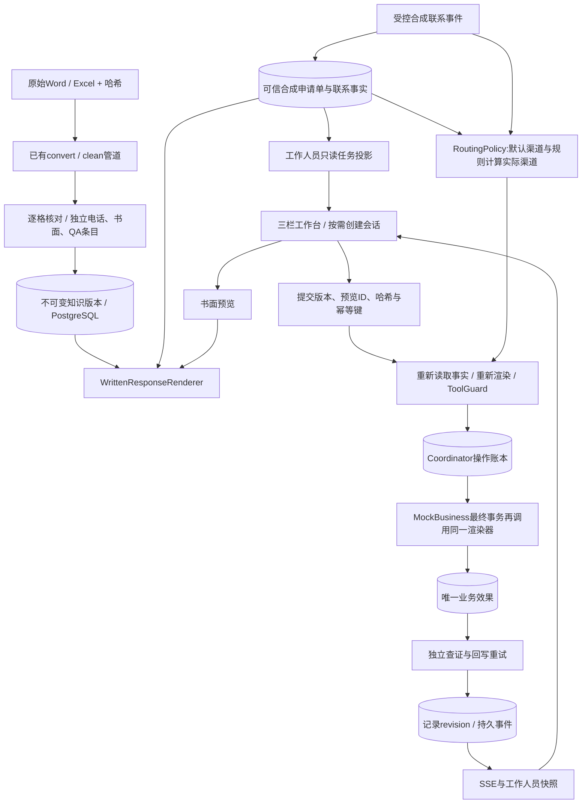

# 资审工作台：业务后端与模拟京麦闭环交付

日期：2026-11-25。

新版本地演示：`http://localhost:13000`，工作人员密码 `staff-local-only`，使用独立新演示库、11个合成任务，初始完成数为0；默认文字模拟，云调用和语音写入关闭。原3000/8000服务及人工数据未改。测试库中的9个完成结果与演示库分开保留。
开发基线 `243ac72`，分支 `codex/workbench-business-backend`，独立工作树 `tmp/v04-business-backend`。本机 `origin/main` 为 `ecefd4b`，是本分支祖先；本机 `main` 仍为较早的 `8ce0868`。基线还包含PR10前端合入及本地验收提交。本轮没有合并main、覆盖其他工作树、推送远端或更新公网部署。

## 基线问题与解决结果

| 基线缺口 | 本轮结果 |
| --- | --- |
| 工作台加载列表批量创建CASE_READY会话 | 新增工作人员只读任务投影；读取和切换任务不创建会话，实际操作时才创建 |
| 话术渠道影响默认路由 | 默认渠道成为ReviewCase的独立可信字段；新增书面知识不会改变电话任务路由 |
| 电话正文被直接写入RejectPayload | Agent仅提议动作，Coordinator、预览和Mock最终事务统一使用WrittenResponseRenderer选择书面模板 |
| 没有工作人员权限与审核事实接口 | 独立工作人员登录、带角色的签名Cookie和owner过滤；商家登录不授予工作人员权限 |
| 没有书面预览和执行入口 | 提供权威正文、来源、槽位缺口、版本、哈希、可执行原因；受控POST不接受任意正文 |
| 未接通只有规则试算 | 新增仅开发/测试可用的合成联系事件适配器，真实持久化联系事实、跟进操作和后续驳回 |
| 挂断后缺少后续执行 | 已完成身份/告知的文本模拟会话，可挂断后执行书面流程；不改变语音写入和可信播放要求 |
| 回写记录已存在时忽略后续操作 | 同一记录ID按revision更新并留持久事件；首次通话记录与最终业务回写分别确认 |
| 开场被协调器覆盖成固定输入句式 | 协调器、Agent与历史演示Agent均删除固定输入要求，保留模拟身份声明和严格身份守卫 |

## 原件、映射与审核版本

原始ZIP及Word、两份Excel的SHA256均与source-manifest一致。主表A2是关单原则，D13:D80实读68个场景：电话54、京麦14。Word写电话55、京麦13，保留差异并以主表逐行事实作为场景索引；不将子表37+14当作全部场景。清洗结果为80条话术、28条QA。

全部68条已有结构化映射，见 [逐场景映射](workbench-scene-mapping-20261125.json)。原始、清洗、待审核、已审核发布、运行能力、端到端验收分别记录，不能用导入数量代替支持数。

根据用户在本轮明确授权，不等待两位审核人，由Codex逐格核对指定来源，审核记录如实使用“用户委托核对原件”。原有双人审核模式仍可用于其他发布包；本轮采用显式的 `delegated_source_review`，必须记录实际审核人、委托依据和核对范围，CLI发布仍需操作者数据库权限，没有开放前端发布接口。

最终知识版本：`workbench-reviewed-20261125-v3`。共146个条目，其中19个已审核条目：3个电话、6个书面、10个按场景实例化的QA；其余127个隔离待审核。实际发布支持6个主表场景，电话能力3个、书面能力6个，两者重叠，不能相加。QA来自4个独立原始来源：高频QA C2/C12、特殊场景 D22/D24。

| 已发布场景 | 主表行 | 电话来源 | 书面来源 | 本轮验收 |
| --- | --- | --- | --- | --- |
| 授权书内容不完整 | 17 | 特殊场景B20，开场/结束语分段 | E17，逐个命名品牌和两项缺失材料槽位 | 文本告知、问答、驳回、回写；合成未接通分流 |
| 授权时间到期 | 21 | 特殊场景B25 | E21，授权到期日取服务端事实 | 文本闭环 |
| 授权链路不完整 | 22 | 特殊场景B26 | E22，保留D/E52、通用链路B27的核对来源 | 文本告知后挂断、工作人员书面执行、记录revision更新 |
| 资质造假 | 15 | 缺适用已审电话模板 | E15，资质名称和失真事实取服务端槽位 | 直接京麦闭环 |
| 治理停用 | 16 | 缺适用已审电话模板 | E16 | 直接京麦闭环 |
| 无品牌申请 | 24 | 缺适用已审电话模板 | E24，校验申请确为无品牌 | 直接京麦闭环及矛盾事实拒绝 |

未发布的62条保留待审核；相似的入驻场景不自动获得上述品牌场景的发布资格。主表28/59缺少正文，另有残句、模糊有效期、公章回答冲突、样例映射不一致等问题均隔离，详见映射与机器证据。没有让LLM补齐。10个QA条目分别限定授权场景，覆盖上传联系方式路径、固定模板质疑、授权链标准和通过预期；其他QA尚未宣称可回答。

## 架构与数据如何流动

本轮在现有模块化后端内补齐业务能力，没有新增微服务，没有重写WebRTC、流式TTS、队列或取消生命周期。媒体连接与生成任务仍受既有进程内生命周期限制，本轮不是多实例或低延迟架构升级。



四个维度分开：`ReviewCase.default_route`是默认关单方式；`RoutingDecision.route`是当前事实计算的实际渠道；`KnowledgeEntry.channel`是电话/书面输出形式；`mode/voice_transport`是text、agora、native_webrtc传输方式。默认路由不再从知识条目是否存在推断。

工作人员只读接口展示核验前审核事实，商家快照、消息、事件与语音继续受原身份边界保护。未核验的商家快照不会取得record中的原因、整改或来源；工作人员使用独立授权接口读取完整投影。

电话口语与书面分别选条目；书面预览不调用LLM。聊天和前端不能修改品牌、审核结论、材料缺项、授权关系或日期。书面模板缺槽位、含未解决占位符、内部批注、冲突或未审核时拒绝执行。QA匹配独立于电话主说明，QA本身不能充当完整告知证据。工作人员投影只恢复当前审核版本的会话，旧版本关单保留为历史，不能计入新版本完成数。

预览ID绑定申请全部可信事实、会话、state_revision、知识正文及条目、规则、路由、联系事件和告知证据。执行重新渲染，并重验归属、角色、审核版本、知识/规则版本、正文哈希与告知条件。Mock最终业务事务再按当前申请和同一知识版本渲染，防止排队后事实变化。业务键继续覆盖申请、审核版本和动作，跨会话不会产生重复驳回效果。联系事件与跟进命令使用同一事务内的申请快照，避免另一连接读到旧联系次数或漏记event_id。二次提交再次未接通后，只有查到同审核版本首次未接通所产生的成功跟进记录才可执行驳回，历史次数本身不能授权。

业务操作成功不等于回写成功；unknown保留原operation继续查证，回写失败只重试回写。跟进操作回写成功只表示已登记再次联系，工作台不会将它计入驳回完成数。

## 新增API与前端接线

| API | 用途与边界 |
| --- | --- |
| POST /api/v1/auth/staff/login | 独立工作人员凭据；普通商家登录不获得角色 |
| GET /api/v1/staff/applications | 只读队列、默认/实际渠道、状态与可恢复快照 |
| GET /api/v1/staff/applications/{id} | 审核事实、品牌/分类/次数、联系事实、完整路由证据与版本 |
| GET /api/v1/staff/support-catalog | 原始统计、审核发布条目/场景、电话/书面能力、可渲染任务及不可用原因 |
| GET /api/v1/staff/sessions/{id} | 经工作人员授权的完整会话投影 |
| GET /api/v1/staff/sessions/{id}/written-preview | 权威正文、来源、版本、槽位缺口、哈希及执行条件；无业务效果 |
| POST /api/v1/staff/sessions/{id}/reject | 只接受版本、预览标识、正文哈希及Idempotency-Key；任意正文额外字段被拒绝 |
| POST /api/v1/staff/sessions/{id}/contact-events | 仅开发/测试、文本合成任务可用；事件去重、版本与联系次数CAS；不接收verified |

新增Pydantic DTO位于staff_contracts.py，扩展了ReviewCase、ContactOutcome及安全的contact.recorded持久事件。OpenAPI、JSON Schema及前端生成类型均由脚本实际导出，公共API元信息为0.4.1；旧实时0.4.0内部契约和Capabilities兼容字段保持原值。

前端保留第一版三栏视觉。TaskQueue/TaskContext读取工作人员投影，Overview读取支持目录；WrittenProcess读取后端正文和执行结果；use-workbench只在显式处理任务时建会话，保留恢复、SSE去重与generation过滤；BusinessFacts显示实际联系、操作和回写。技术传输选择与合成未接通按钮留在开发设置，不能替代业务渠道或真实供应商事实。

## 数据迁移、发布与运行

本轮没有关系表DDL变更，复用现有JSONB、收据、操作、业务效果与记录表。新字段有兼容默认值；旧会话可恢复。历史申请和知识版本不会被种子覆盖。已存在但矛盾或缺槽位的旧申请会拒绝执行，不自动“修好”审核事实。

已知历史合成任务可先运行 `scripts/migrate_workbench_tasks.py` 查看仅补缺失元数据的计划，明确执行 `--apply`才写入；不改已有事实、slots、case_revision、知识版本或会话历史。旧无品牌任务若品牌事实不是“无品牌”，须由业务负责人核实，不能靠迁移脚本覆盖。

发布沿用原管道，在设置PYTHONPATH=backend后：

```powershell
python scripts/convert_private_sources.py <原始ZIP> --output private-evidence/business/staging.json
python scripts/prepare_knowledge_review.py private-evidence/business/staging.json --all-scenes --delegated-review --release workbench-reviewed-20261125-v3 --output private-evidence/business/reviewed-release-v3-final.json
python scripts/publish_reviewed_knowledge.py private-evidence/business/staging.json private-evidence/business/reviewed-release-v3-final.json
python scripts/publish_reviewed_knowledge.py private-evidence/business/staging.json private-evidence/business/reviewed-release-v3-final.json --publish
```

审核包含实际委托记录、来源哈希、条目、范围、槽位和审核人。原件及包保留在忽略的private-evidence下；公开代码不携带私有工作簿。发布版本不可变，修改需新版本；新会话用ZHIYU_KNOWLEDGE_VERSION绑定版本，旧版本失效时拒绝继续派发。

`seed_workbench()`仅创建合成任务并保留已存在申请，用于独立演示库。完整测试必须使用独立_test数据库；scripts/verify_workbench.py拒绝占用现有服务端口，支持独立18000/13000端口；原verify_browser_flow.py入口兼容转到当前工作台验收，CI使用--workbench准备合成任务。容器验证脚本已接线，未在本机重跑Docker流程。

## 测试、证据与实际话术

精确计数、JUnit结果、原件哈希、审核包哈希、支持目录、9份实际书面命令及重渲染一致性，见 [机器证据](workbench-business-evidence-20261125.json) 和 [业务闭环事实](workbench-test-results.json)。

全量后端516项通过，0失败、0跳过，包含原实时模块、业务模块、授权、模板及故障恢复回归。前端类型检查和Webpack生产构建通过。正常npm ci环境的默认构建交由CI；本机依赖链接跨根，未将Webpack结果冒充默认Turbopack构建。浏览器4项通过，覆盖只读零会话、授权三场景、核验前字幕隔离、原始QA、四类直接京麦、三次提交、未接通后实际跟进再联系、挂断后执行、重复点击、刷新恢复、未知/人工状态、失败加载及桌面/移动布局。

数据库核对：10个按需会话、10个成功操作、10个业务效果、10条回写。其中9次驳回、1次再次联系跟进，最终9个申请完成驳回闭环；不是10个申请已驳回。各会话事件seq连续，9份实际正文与当前申请、已审核书面条目权威重渲染一致。

实际电话说明示例（合成商家1，原件B20分段）：

> 您好，这里是模拟商户服务AI演示。请问您是演示商家1的联系人吗？
>
> 联系您是因为您申请的合成品牌1品牌，提供的授权书缺少授权期限、被授权方盖章，请补齐后重新提交。

实际书面正文示例（同一申请，E17渲染）：

> 【模拟演示】尊敬的商家伙伴您好，我是模拟商户资审告知助手，您申请的合成品牌1品牌，因授权书内容不完整，缺少授权期限、被授权方盖章，请补齐后重新提交，如有疑问您可以电话联系：4006180092，我们将竭诚为您服务！

电话和书面是两个独立条目，没有用商家聊天补写材料事实。电话号码为原件所载，不代表本轮核验过其当前运营状态；演示不会拨打真实号码。

真实云语音回归仅1次建连、2轮固定合成音频、3次TTS尝试，保留默认调用上限。输入适配器预留8轮是本地保守预算，不表示发送了8轮音频；未取得供应商账单金额。该回归使用v1，验证媒体、最终字幕、原件电话说明、打断、音量和恢复；随后v2补充独立QA，v3进一步将电话缺项列表与书面申请事实对齐。最终v3完成文本/书面验收，没有追加v3云QA回归。物理麦克风、弱网/TURN和可信播放不在该合成音频证据范围内。详见 [语音证据](workbench-voice-test-results.json)。

页面截图保留在本工作树.cache/workbench：written-preview.png、phone-desktop.png、contact-closed-desktop.png、contact-closed-mobile.png及workbench-voice-desktop.png。全部为合成商家，不含真实商家资料。

## 尚未完成与下一步

- 原始68条中还有62条未发布，24条原始QA尚未逐项发布；不能宣称全场景覆盖或官方评分通过。
- 默认京麦的造假、治理、无品牌场景进入回电例外时，缺少适用电话模板会安全阻止自动回答/执行，需继续核对对应电话知识。
- 真实电话供应商联系事件尚未接入；合成适配器不是供应商未接通证明，staging不开放合成入口。
- WebRTC仍没有独立可信播放证据，语音业务写入保持关闭；媒体通过不能当作完整语音关单。下一阶段须在不放宽守卫的前提下接入可信播放验收。
- 最终v3没有新增30轮同条件真实云延迟测量，不声称P50仍低于2秒；没有重测官方RSI评分。
- 本轮没有多实例改造、真实京麦接口、真实外呼、生产身份系统或公网部署。工作人员凭据和owner隔离是可验证的演示授权，生产需接组织身份和租户权限。


## 主要修改文件

后端新增staff.py、staff_routes.py、staff_contracts.py、written.py、agent/reviewed_qa.py；修改contracts.py、coordinator.py、guard.py、adapters.py、knowledge_templates.py、agent/semantic_agent.py、main.py、config.py、seed.py。RSI离线夹具同步区分电话/书面知识，模拟器也使用权威书面渲染，不修改原始dev/holdout语料。

前端修改use-workbench.ts、workbench.ts、TaskQueue、TaskContext、WorkbenchOverview、WorkbenchPage、BusinessFacts、BusinessWorkflow、SubtitlePanel及少量队列样式，新增WrittenProcess；未改RealtimeVoicePanel、realtime.ts或WebRTC媒体处理。本轮新增test_staff_workbench.py、test_reviewed_qa.py，更新原断言和浏览器用例以覆盖新契约。

数据与交付脚本：clean_competition、prepare_knowledge_review、publish_reviewed_knowledge增量扩展；新增workbench_knowledge、migrate_workbench_tasks、report_workbench_delivery；更新浏览器验证入口、CI、compose工作人员配置、README、契约说明与由生成器导出的Schema/OpenAPI/前端类型。原件、私有审核包和运行日志均未纳入Git。
