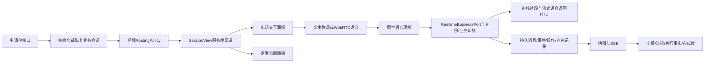

# 第一版资审工作台交付与验收

## 参考与范围

使用 `E:/桌面文件/开发/zhiyu-workbench.html` 第一版（v0.4）作为视觉与交互参考，未使用V0.5。保留墨绿色、浅灰绿底、白色卡片、三栏队列/任务/业务状态布局，改用现代无衬线中文字体。移动端按队列、任务、状态纵向排列。

保留参考的信息组织，不移植其8条模拟任务、浏览器朗读或本地状态推进。实际任务来自后端申请单；页面上的合成任务属于现有后端种子。赛题ZIP与现有source-manifest的SHA256一致，原始主表68条、默认电话54条、京麦14条。它们与实际发布支持数分开展示；当前API没有发布支持目录，不能宣称支持全部68场景。

工作分支 `codex/workbench-v1-20261125`，独立工作树 `tmp/v04-latency`。未修改主工作区的既有实验改动，未推送或更新公网部署。

## 组件及修改文件

| 文件 | 职责 |
| --- | --- |
| frontend/app/page.tsx、WorkbenchPage.tsx | 页面入口、工作人员登录、三栏组装、电话/京麦差异化、开发设置 |
| frontend/app/WorkbenchOverview.tsx | 原表统计及当前加载任务真实完成数 |
| frontend/app/TaskQueue.tsx | 申请单队列、渠道筛选、选中与通话时切换保护 |
| frontend/app/TaskContext.tsx | 商家/版本、审核事实、服务端渠道与接口缺口 |
| frontend/app/BusinessWorkflow.tsx、BusinessFacts.tsx | 纵向流程、告知/操作/回写事实、持久事件与来源 |
| frontend/app/RealtimeVoicePanel.tsx、frontend/lib/realtime.ts | 复用RTC生命周期，补充真实采样RMS麦克风音量显示 |
| frontend/lib/use-workbench.ts | 会话恢复、受控会话初始化、SSE、幂等请求、任务状态管理 |
| frontend/lib/workbench.ts、api.ts | 复用生成DTO，标签/完成条件、HTTP错误类型 |
| frontend/app/layout.tsx、workbench.css | 页面元信息、第一版视觉和响应式布局 |
| frontend/tests/smoke.spec.ts、business-facts.spec.ts、workbench.spec.ts | 新工作台验收，替换旧单栏商户页断言 |
| scripts/verify_workbench.py | 隔离数据库下启动浏览器验收并交叉检查持久业务事实 |
| scripts/verify_workbench_voice.cjs、docs/workbench-voice-test-results.json | 固定合成音频的真实云语音回归及脱敏证据 |
| docs/workbench-api-gaps-20261125.md、workbench-test-results.json | 接口缺口与脱敏测试结果 |

继续复用SubtitlePanel、VoicePanel、RealtimeVoice、routing-preview和api.generated；后端核心契约、状态机、RoutingPolicy、安全守卫及业务执行未作变更。

## 数据流与接口映射

业务渠道是后端决定的phone/jingmai/manual；text/agora/native_webrtc只是电话联调的传输选择，放在开发设置中。前端不以传输选择改变业务路由。

| 接口 | 工作台用途 |
| --- | --- |
| GET applications、capabilities | 申请单和当前环境能力；不视为发布目录 |
| POST sessions / GET sessions/{sid} | 获得服务端route和状态，恢复同一申请单上下文 |
| POST sessions/{sid}/start、turns | 开场与文字联调，继续保留版本和幂等键 |
| GET sessions/{sid}/events | 持久事件补读，按seq去重、按generation过滤字幕、断线重连 |
| POST interruptions、end | 取消与结束；不直接设置业务完成 |
| 现有RealtimeVoice信令/控制/媒体接口 | 浏览器麦克风→RTC→理解与业务审核→流式音频→浏览器 |
| GET/POST dev/routing | 仅开发设置中的规则试算，不改变任务或写入未接通事实 |

由于缺少只读任务路由投影，首次加载会为没有可恢复会话的申请创建CASE_READY文本会话。这会持久化会话和路由事实，但不启动模型、语音或业务操作。会话ID和初始化幂等键保存于localStorage；业务状态只从后端读取。缓存不构成授权或成功凭据。

商家字幕只展示后端会话消息；工作人员事实卡不拼入商家话术。核验前的原因/整改隐藏继续遵守既有API边界。挂断与会话ended不等于告知完成；告知以record.explanation_status为准，关单计数需CLOSED、持久record和成功业务操作共同成立。unknown、failed、人工介入及等待回写单独显示。

## 验证与实际边界

类型检查与Webpack生产构建通过。默认Turbopack受本机跨根依赖链接限制，本次未将Webpack构建等同于正常npm ci环境的默认构建。

隔离PostgreSQL测试库，FakeModel + MockBusiness，4项浏览器回归通过：

- 三类授权场景：缺项、过期、链路不完整，分别完成身份核验、整改问答、业务操作、回写与刷新恢复。核验前字幕不含品牌或具体授权原因。
- 直接京麦：读取真实服务端jingmai路由，不出现电话组件，执行按钮因缺少受控接口而禁用，未伪造提交成功。
- 未接通规则：第一次提交首次未接通→京麦；第二次提交首次未接通→二次外呼跟进；第二次提交二次未接通→京麦。通过浏览器调用真实dev/routing验证，仅为规则试算，尚未验收供应商联系事件端到端执行。
- unknown/人工介入、挂断未闭环、任务读取失败、渠道筛选、刷新恢复、桌面/390px移动布局与无横向溢出。

数据库交叉核对：7个任务会话；3个CLOSED且已核验的授权任务；3个succeeded操作、3个Mock业务效果、3条业务记录；各会话持久事件seq连续。详见workbench-test-results.json。

真实云语音回归也通过：Chromium MediaStream注入两段固定合成音频，使用真实WebRTC、原生理解供应商与流式TTS，核对开场字幕、身份识别、整改回复、不承诺必过、真实采样音量变化、打断保留历史、挂断、刷新恢复及移动端无横向溢出。没有浏览器运行时错误。此为合成音频媒体链路测试，不替代用户物理麦克风/声卡测试；没有声称可信播放验收、真实业务写入或30轮P50验收。详见workbench-voice-test-results.json。

截图在.cache/workbench下：phone-desktop.png、phone-mobile.png、jingmai-desktop.png、voice-desktop.png、voice-mobile.png。属于合成环境验收截图，不含比赛源文件的私有商户资料。

复现前先完成生产构建，在专用空白_test数据库迁移并调用seed(include_routing_fixtures=True)，设置DATABASE_URL、DEMO_PASSWORD、PLAYWRIGHT_BROWSERS_PATH，运行python scripts/verify_workbench.py。脚本拒绝占用已有服务端口，不重置数据库，结束时仅停止自身服务。语音回归另需运行已配置供应商的人工服务，设置WORKBENCH_AUDIO_DIR指向含merchant-1.trimmed.wav与merchant-2.trimmed.wav的固定合成音频目录，再运行node scripts/verify_workbench_voice.cjs。语音测试会产生真实供应商调用与合成业务会话，不能对真实业务环境直接执行。

## 未完成事项与下一阶段

当前能交付可运行的前端工作台，但完整产品验收受后端缺口影响：工作人员核验前事实/品牌/分类/次数、完整路由证据、发布支持目录、书面正文预览与受控执行、供应商未接通事件入口均未提供。京麦不能声称已完成执行验收。详细建议见workbench-api-gaps-20261125.md，需独立后端PR评审鉴权、版本和幂等后接入。

原生理解当前仅提供最终识别消息，不能承诺逐字临时字幕。麦克风音量能帮助判断浏览器是否实际采到声音；RTC已连接不能替代模型理解成功。此次UI改造不构成新一轮30次真实有效答案P50验收，既有延迟结果也不能自动外推到改造后的生产环境。后续补齐工作人员接口和业务执行入口后，再按同音频/网络/业务约束进行完整业务与延迟验收。
